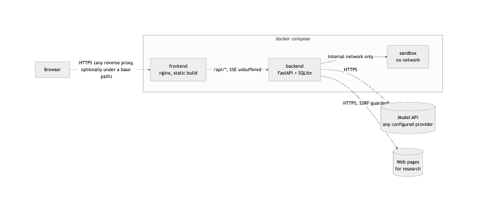
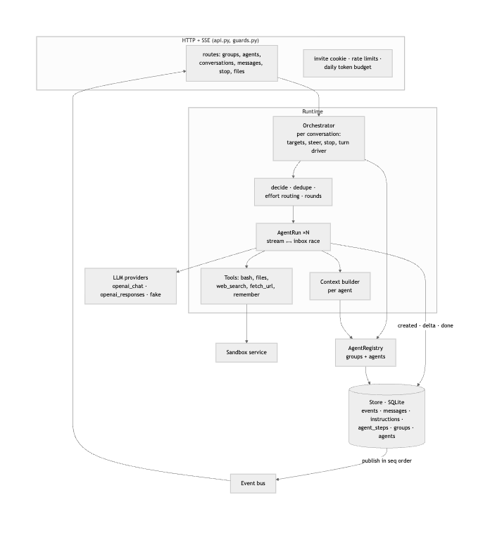
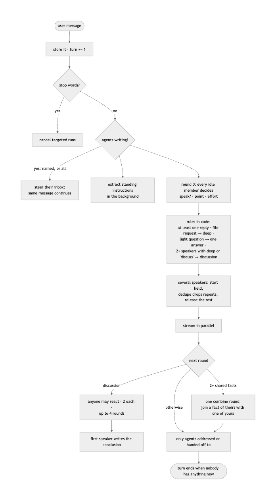
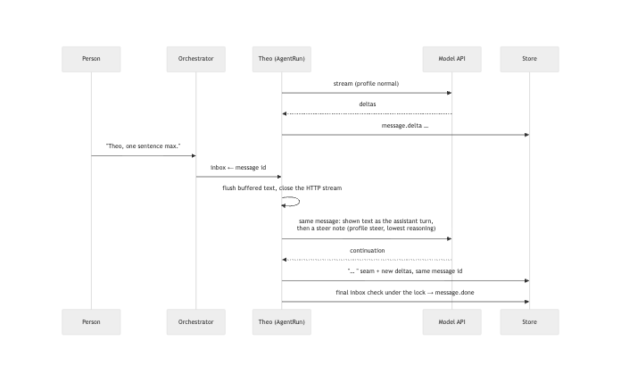

# Huddle

Think a question through with a group of AI agents. Huddle is an open-source group chat where
each agent has its own role, voice and private knowledge the others cannot see. They answer at
the same time, talk to each other, combine what they know, stay quiet when they would only repeat
someone, and can be redirected mid-sentence: the answer they are writing changes right there.

Three groups ship as presets — a startup leadership team (3: **Mira** CFO, **Theo** CTO, **Juno**
Head of Customers), a family planning the summer (5) and a product-launch war room (10) — and any
group can be edited or extended in the app.

## Quick start

```sh
cp .env.example .env          # set the key for the model you use
docker compose up --build     # frontend, backend + SQLite, sandbox
```

Open <http://localhost:8080>. No key? Set `HUDDLE_MODEL=fake` in `.env` to click through
with a scripted model.

**Running it for others.** Put any HTTPS reverse proxy in front of port 8080 (it listens on
`127.0.0.1` unless `HUDDLE_BIND` says otherwise; a base path such as `/huddle/` is supported) and turn on the protections in `.env`: an invite code, per-client rate
limits, a daily token budget and workspace cleanup. Every setting is described in
[docs/configuration.md](docs/configuration.md); what the sandbox does and does not defend is in
[SECURITY.md](SECURITY.md).

**Switching models is configuration only.** `HUDDLE_MODEL` picks an entry in
[`config/huddle.yaml`](config/huddle.yaml): `minimax` (MiniMax-M3.1-Flash), `deepseek`
(deepseek-flash), `openai` (Chat Completions with `OPENAI_API_KEY`), `openai-plan`
(Responses API with a token file), `fake`. Each entry lists per-profile request
parameters, so "steer", "decide", "light" and "deep" calls get different reasoning levels.

## Try this

Pick a group when you start a new chat. In the startup group:

- "Should we take the Acme deal?" — needs Juno's deal terms, Theo's capacity and timeline,
  and Mira's runway rule; no single agent can answer it alone.
- While they write: "Theo, one sentence max." — only Theo changes, mid-answer.
- "from now on, answer in Chinese" — everyone who is writing switches now; later turns too,
  also after a reload.
- The **Stop** button (or Esc, or typing "stop" / "Mira, stop").
- "Theo, write a phased rollout plan as plan.md" — he works in the sandbox; the file
  appears in the Files panel.
- Click an avatar to edit that colleague's **Soul** (who they are) and **Memory** (what only
  they know). Click **+** to add a colleague. "Mira, remember that I hate jargon" — she saves it
  to her memory and keeps it in later conversations.
- "Let's discuss: should we finish Kestrel before we sign Acme?" — a free discussion over a few
  rounds, then one of them writes the conclusion and the open disagreements.
- "Juno, research how long SAML SSO integrations take and save what you find" — she searches the
  web and reads pages; every source lands in `research/` in the Files panel, plus her summary file.
- "What's 15% of $2.52M?" — one short answer from one colleague, not a chorus.

In the family group: "Can we do the Italy trip in July?" (Nonna's surgery, Mom's work, Mia's camp
and a cousin's apartment decide it). In the launch war room: "Are we ready to launch on the 14th?"
(a sync fix, App Store review time, legal and accessibility deadlines, across ten people).

## Architecture









The diagrams' Mermaid sources and the design decisions are in [docs/architecture.md](docs/architecture.md).

## How it works

See [docs/architecture.md](docs/architecture.md) (diagrams) and the specs in
[docs/specs/](docs/specs/). The short version:

- **One event log is the truth.** Every visible change is an event with a per-conversation
  `seq`, written together with its table change in one SQLite transaction under one lock,
  then published in that order. The browser loads a snapshot consistent with a `seq` and
  applies later events, detecting gaps. A reload replays the same log, so order is
  defended, not hoped for. A message's place is fixed when its first word appears.
- **Steering is our own loop.** Each agent message is a run that races the model stream
  against an inbox. A steer closes the HTTP stream at once, keeps exactly the text the
  reader already saw, and asks the model to continue *that same message* with the steer
  applied, using the provider's lowest reasoning setting (~1 s to the first new word).
  Between tool calls the steer lands at the next model call; a running command is killed.
  A final inbox check under the lock before a message is marked done means a late steer is
  never ignored. Steering one agent by name leaves the others untouched.
- **Standing instructions** are extracted from every user message, stored, placed at the end of every later system prompt (just before the rule that no instruction changes
  who an agent is) and repeated as a reminder in the final turn of each call.
- **Groups:** a group is a set of agents plus shared context (what everyone in it knows). Each
  conversation belongs to one group; members, souls, memories and shared context are stored in
  SQLite and editable in the app (up to 10 members per group). Prompts contain no preset names or
  facts, so the same rules work for a family as for a company.
- **Effort routing:** a light, general question gets one light answer; a request for a file runs at
  deep effort (the only level with sandbox and web tools; `remember` is offered only when the person asks
  for something to be remembered, since memory is shared by every conversation of the group); a hard question several agents want to take on, or an
  explicit "discuss/debate", becomes a **free discussion** — everyone may react for up to four rounds
  (two messages each, tool-free, chat-length), then the first speaker writes the conclusion.
- **Combining knowledge:** after a first round where two or more agents shared substantive facts,
  everyone gets one combine round: speak only to join a fact someone just shared with one of your own
  into a conclusion nobody stated (a timeline against a deadline, a cost against revenue).
- **Who speaks:** each agent first decides from its own context whether it has something
  new, its one-line point, and how much effort the question deserves (`light`/`normal`/
  `deep`, which sets length, token cap, reasoning level and tool access). When several want
  to speak they start writing while a dedupe pass decides who repeats whom; dropped answers
  never become visible. Every user message gets at least one reply, except a stop or a message that only
  redirects agents already writing. After that, only agents
  someone addressed may answer, for at most two rounds — the exchange ends on its own.
- **Private context per agent:** its soul, its memory, the group's shared context, the shared
  transcript, and only its own tool history. Soul and memory are markdown stored in SQLite,
  editable in the UI; an agent can append to its own memory with a `remember` tool. Context
  use is shown on each agent's profile. A standing instruction can change language, length or
  format, but not who an agent is: asked to "all sound like one cheerful assistant", they keep
  their own voices.
- **Thinking models with tools:** reasoning returned by the model is stored with the tool
  calls it led to and passed back on the next call (DeepSeek requires this in thinking mode).
- **Sandbox:** `bash`, `read_file`, `write_file` run in a separate container with no network,
  a non-root user, a read-only root filesystem, and CPU / memory / process / time limits.
- **Web research:** `web_search` and `fetch_url` run in the backend (the sandbox has no network),
  refuse private, loopback, link-local and metadata addresses on every hop, cap size and time, and
  save every result as a markdown note with its source in the workspace.

## Evaluation

`eval/cases/*.yaml` holds 36 scripted conversations across the three groups (3, 5 and 10 agents) that interrupt, steer by name, stop,
reload, burst messages, try prompt injection and hostile shell commands, and ask questions
that need two agents' knowledge. `eval/run.py` drives a running Huddle black-box over HTTP +
SSE, applies deterministic checks (ordering, same-message continuation, stop, reload
identity, privacy leaks, steer latency) and asks a judge model about behaviour.

```sh
uv run --project backend python eval/run.py --base http://localhost:8080 --judge deepseek
```

## Tests

- Backend (249 tests, scripted fake model, no network): `cd backend && uv run pytest -q`
- Frontend: `cd frontend && npm test && npm run typecheck && npm run build`
- Sandbox: `cd sandbox && uv run --with pytest pytest -q`
- Eval runner: `uv run --project backend --with pytest pytest eval/tests -q`
- Containers: `HUDDLE_MODEL=fake bash scripts/smoke.sh`

## Scope cuts and known gaps

- **One process, one user.** No accounts. Running answers live in memory; a backend
  restart ends them (they are marked stopped, nothing is lost or reordered).
- **One sandbox container for all conversations**, one directory per conversation, not a
  container per conversation: a shell command can reach other conversations' files (which,
  without accounts, everyone can open anyway). A fork bomb is contained by the process limit and
  cleaned up, but can briefly slow other conversations' tools. See [SECURITY.md](SECURITY.md).
- **Text already shown is never retracted.** A steer changes everything after the point of
  interruption; a short "…" marks the seam when it falls mid-sentence.
- **Dedupe and silence are model judgements.** Rules in code bound them (at least one reply,
  rounds only for addressed agents, caps), but an agent can still occasionally repeat a point.
- **Held answers cost tokens:** when several agents start and one is dropped as redundant,
  its partial generation is paid for.
- **Instructions are followed as well as the model follows them** — e.g. MiniMax sometimes
  ran past a "under 40 words" rule.
- **A new message while the previous turn is still deciding** supersedes that turn; the new
  turn sees both messages.
- **Judge scores are noisy**; the deterministic checks are the hard gate.
- **Groups are shared by everyone using an instance.** Edits to a soul or memory affect all
  conversations of that group; "Reset this group" restores the preset.
- **Combining knowledge is structured, not guaranteed.** Agents are told to state their own facts
  as they are (the original ask and deadline, not only their preferred compromise); after several
  agents share facts, one combine round lets anyone join a fact of theirs with one of their own;
  a hand-off ("that's Theo's call") invites the named agent. On the three combine cases, run three
  times each, judged statements went from 22/27 to 26/27; a fact can still occasionally be left out.
- **Web search uses DuckDuckGo's HTML endpoint** (no key); from a cloud IP it sometimes returns
  nothing, and the agents say so.
- **Steering lands within one model response.** A fast model finishes a short answer in about a
  second, so a steer that arrives after it ended becomes a reply in a new message instead.
- Token counts are an estimate (chars/4 for ASCII, 1 per other character).

## Contributing and license

See [CONTRIBUTING.md](CONTRIBUTING.md). Licensed under the [Apache License 2.0](LICENSE).
