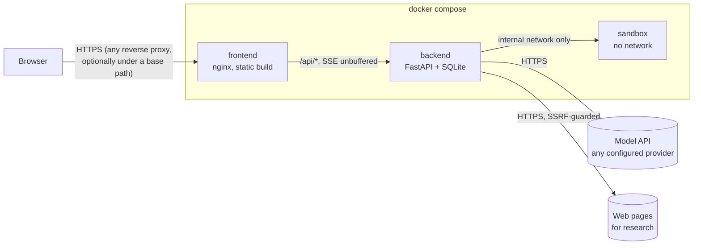
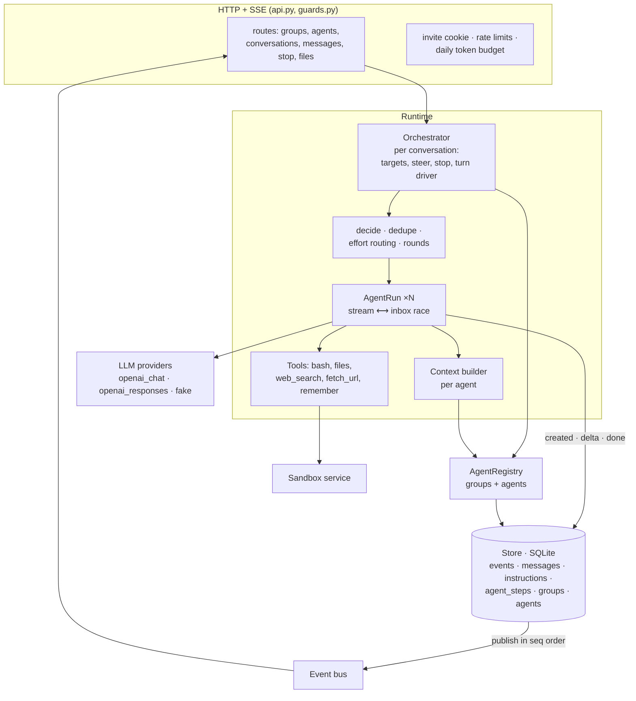
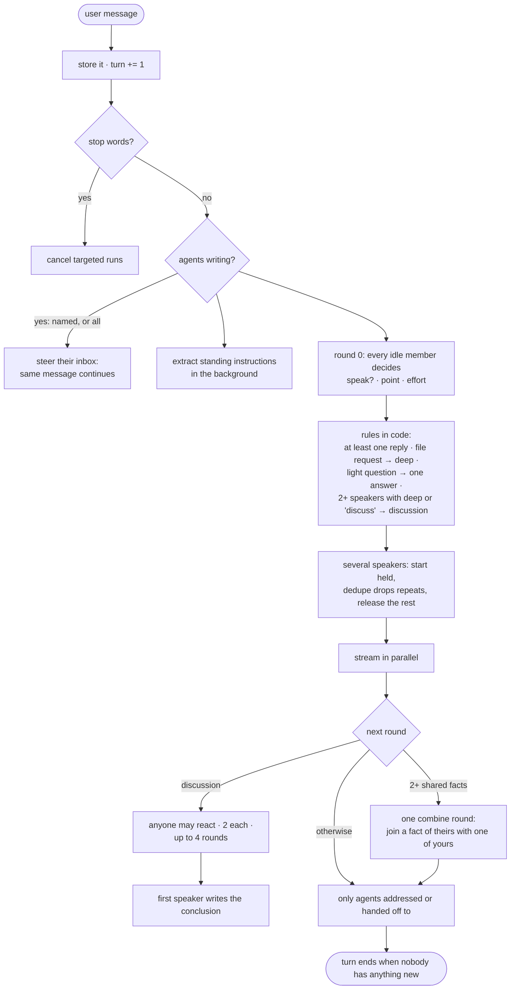
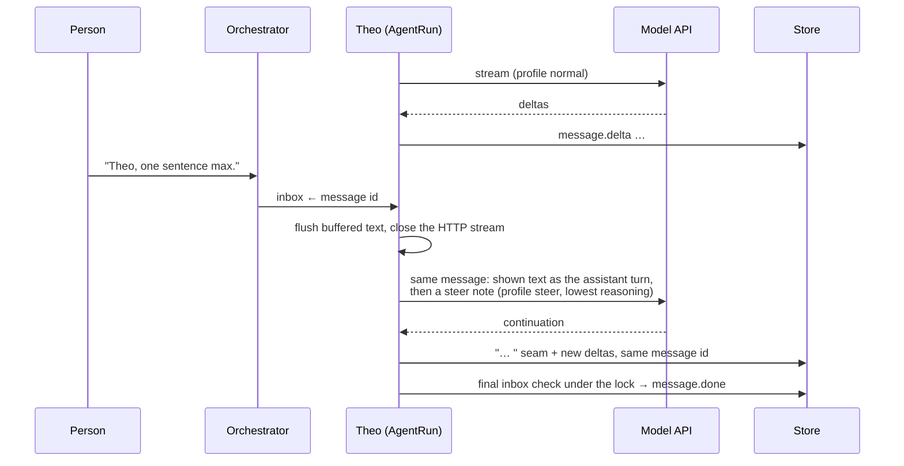

# Huddle architecture

Huddle is a group chat between one person and a group of AI agents. A **group** is a set of
agents plus shared context; each agent has a soul (voice, temperament) and a memory (private
facts nobody else in the group sees). Agents answer at the same time, talk to each other, stay
quiet when they would only repeat someone, and can be interrupted mid-sentence: the answer they
are writing changes right there. Three groups ship as presets (3, 5 and 10 agents); any group can
be edited or extended in the app.

## Running it

`docker compose up` runs everything. In production put any HTTPS reverse proxy in front; the app supports a
base path (`HUDDLE_BASE_PATH`), trusted forwarding headers (`HUDDLE_TRUST_PROXY`), an invite code, rate limits
and a daily token budget — see [configuration](configuration.md).

## Components

## One user message, end to end

## Steering inside an answer

## Design decisions

**One event log is the truth.** Every visible change is an event with a per-conversation `seq`,
written with its table change in one transaction under one lock and published in that order. The
browser loads a snapshot consistent with a `seq` and applies later events, detecting gaps. A
reload replays the same log, so order is defended, not hoped for. A message's position is fixed
when its first word appears.

**Steering is our own loop.** Each agent message is an `AgentRun` racing the model stream against
an inbox. A steer closes the HTTP stream, keeps exactly the text the reader saw, and asks the model
to continue that same message with the steer applied, at the provider's lowest reasoning setting
(about a second to the first redirected word). Between tool calls a steer lands at the next model
call and a running command is killed. A final inbox check under the lock before `message.done`
means a late steer is never ignored.

**Groups make the runtime scenario-free.** The orchestrator reads the members of the
conversation's group from the registry on every turn; prompts contain no preset names or facts.
Scenario content lives only in `config/groups/` (seeds) and in the database (edits).

**Instructions persist; identity is protected.** Every user message also goes through an extractor
that stores durable directives; they sit at the end of every later system prompt (just before the identity
rule) and are repeated at
the end of each call. A directive can change language, length or format, never who an agent is.

**Who speaks.** Silence is the default. Each agent first decides from its own context whether it
has something new and how much effort the question deserves; rules in code bound the outcome
(a reply for every message except a stop or one that only redirects agents already writing, one answer for light questions, deep effort for file requests, a cap
per turn that grows with big groups). Agents state their own facts as they are; after several have
shared facts, one combine round lets anyone join a fact of theirs with one of their own.

**Private context per agent.** Soul, memory, the group's shared context, the shared transcript and
only its own tool history. An agent can append to its memory with `remember`.

**Tools.** `bash` and files run in a separate container with no network, a non-root user, a
read-only root, and CPU, memory, process and time limits (fork bombs are cleaned up). Web research
runs in the backend with address checks on every hop, and every source is saved as a note in the
workspace.

**Any model by configuration.** `config/huddle.yaml` lists providers with per-profile parameters
(`decide`, `steer`, `light`, `normal`, `deep`, `utility`). Provider quirks stay in `huddle/llm/`
(e.g. DeepSeek's reasoning passback and its native tool markup).

## Specs

- `docs/specs/contracts.md`: config, database, events, HTTP API, sandbox API.
- `docs/specs/runtime.md`: LLM interface, context, agent run, steering, orchestration, prompts.
- `docs/specs/sandbox.md`, `docs/specs/frontend.md`, `docs/specs/testing.md`, `docs/specs/eval.md`.
