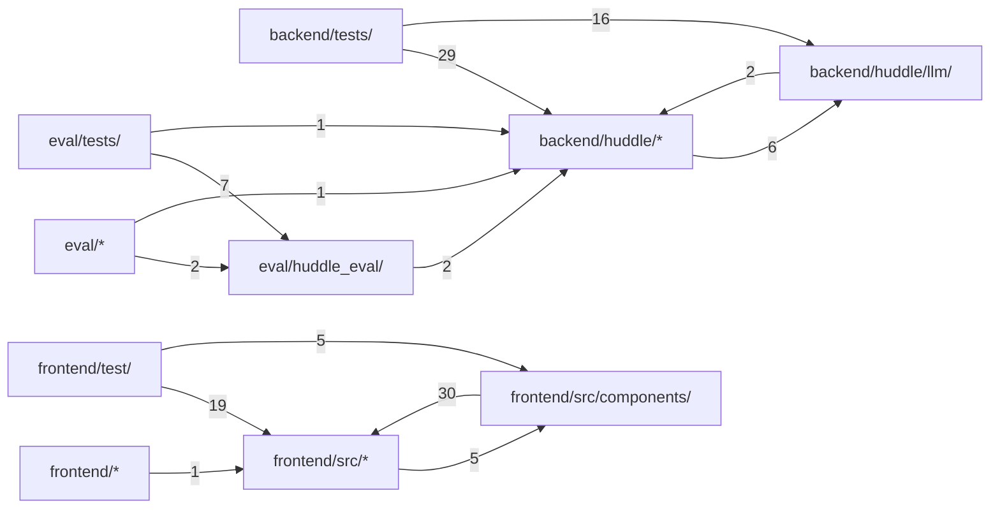

# Huddle

**English** · [中文](zh/all.md)

This book is for someone evaluating Huddle: what it does, how one message flows through the runtime, how mid-answer steering stays consistent, and where it stops. It builds on the [architecture overview](../architecture.md), [configuration](../configuration.md), [SECURITY.md](../../SECURITY.md) and the [specs](../specs/) instead of repeating them.

## Overview

Huddle is a web group chat between one person and a group of AI agents. Each agent has a soul (who it is) and a private memory; several stream answers at once, talk to each other, stay quiet when they would only repeat someone, and can be redirected while they write, in the same message.

Two objects carry the runtime: the per-conversation `Orchestrator` decides who speaks ([How a turn works](#how-it-works)), and one `AgentRun` per visible message writes it and absorbs steers ([Steering mid-answer](#steering)). The [architecture overview](../architecture.md) has the diagrams and design decisions, [configuration](../configuration.md) every setting and [SECURITY.md](../../SECURITY.md) what the sandbox defends; [Code structure](#structure) shows the code layout. Huddle is Apache-2.0 licensed; [CONTRIBUTING.md](../../CONTRIBUTING.md) says where changes go.

Sources: [orchestrator.py:30-44](../../backend/huddle/orchestrator.py#L30-L44) · [agent.py:65-97](../../backend/huddle/agent.py#L65-L97) · [LICENSE:1-3](../../LICENSE#L1-L3)

### Running it

`docker compose up --build` starts three services: the static `frontend` on port 8080 (bound to `${HUDDLE_BIND:-127.0.0.1}`, so only this machine by default), the FastAPI `backend` with its SQLite file on a volume, and the `sandbox`. The sandbox sits only on an `internal` network: the backend can reach it, the internet cannot be reached from it. Setting `HUDDLE_MODEL=fake` runs a scripted model without any key.

`create_app` wires the store, the registry, the orchestrator and the sandbox client; at startup it refuses to run when the active model, or a model named by a stored member, has no key, marks messages left `streaming` by a previous process as stopped, and loads the groups.

To serve it to others, put any HTTPS reverse proxy in front of the frontend; `HUDDLE_BIND`, base path, unbuffered SSE and forwarded client addresses are covered in [Running behind a reverse proxy](../configuration.md#running-behind-a-reverse-proxy).

Sources: [docker-compose.yml](../../docker-compose.yml) · [main.py:28-87](../../backend/huddle/main.py#L28-L87) · [configuration.md:93-104](../../docs/configuration.md#L93-L104)

### Switching models

The model is chosen by configuration: `HUDDLE_MODEL` selects an entry under `models:` in `config/huddle.yaml` (`deepseek` by default), and `make_llm` builds its provider (`openai_chat` for any Chat Completions API, `openai_responses`, or `fake`). No code names a model.

Every call passes a *profile*: `decide`, `steer`, `utility`, or the effort levels `light`, `normal`, `deep`. `params_for` deep-merges the entry's `default` params with that profile's, which is how one setting gives steers the lowest reasoning level and deep work more. An agent may name its own model; `Orchestrator._llm` caches one client per model key. The fields are documented under [Models](../configuration.md#models).

Sources: [huddle.yaml:1-46](../../config/huddle.yaml#L1-L46) · [config.py:57-66](../../backend/huddle/config.py#L57-L66) · [__init__.py](../../backend/huddle/llm/__init__.py) · [orchestrator.py:132-136](../../backend/huddle/orchestrator.py#L132-L136)

### Provider quirks stay in adapters

The runtime sees one stream of `TextDelta`, `ToolCallDone` and `Done` events. `OpenAIChat` hides the differences: `_ThinkFilter` drops `<think>` blocks, `_MarkupFilter` cuts native tool-call markup some models write as text (and reports the cut as `wanted_tools` on `Done`, see [Steering mid-answer](#steering)), and with `reasoning_passback` (set for `deepseek`) every assistant message carries its `reasoning_content`, which thinking models require once tools are involved. Transport errors, 429 and 5xx are retried only before the first event is yielded, so a retry can never duplicate visible text.

Sources: [openai_chat.py:15-41](../../backend/huddle/llm/openai_chat.py#L15-L41) · [openai_chat.py:61-88](../../backend/huddle/llm/openai_chat.py#L61-L88) · [openai_chat.py:101-186](../../backend/huddle/llm/openai_chat.py#L101-L186) · [huddle.yaml:14-23](../../config/huddle.yaml#L14-L23)

### Guards for a public instance

`guards.py` protects an instance that others can reach: an invite code exchanged for an access cookie that `AccessMiddleware` checks before any route runs, per-client rate limits, caps on messages per conversation and on busy conversations, and a daily token budget. Each guard is off unless its environment variable is set, so local runs and tests need none of them. Every model call goes through `MeteredLLM`, which records provider usage or an estimate, so the budget counts decide, dedupe and extraction calls too. Per-client limits key on `client_ip`, which counts `X-Forwarded-For` from the right: the frontend's nginx appends the address it saw and each of the `HUDDLE_TRUST_PROXY` proxies in front appends one more (`true`/`yes`/`on` means one), so entries a client wrote itself are never believed; `is_https` trusts `X-Forwarded-Proto` only behind trusted proxies. The variables are listed in [configuration](../configuration.md); what the sandbox does and does not defend is in [SECURITY.md](../../SECURITY.md).

Sources: [guards.py:1-5](../../backend/huddle/guards.py#L1-L5) · [guards.py:56-131](../../backend/huddle/guards.py#L56-L131) · [nginx.conf:13](../../frontend/nginx.conf#L13) · [guards.py:195-280](../../backend/huddle/guards.py#L195-L280) · [api.py:191-211](../../backend/huddle/api.py#L191-L211) · +1

## How a turn works

The [architecture overview](../architecture.md) draws one user message end to end. This page follows the code: how events are ordered, what happens when a message arrives, how agents decide to speak, and why a turn ends by itself. Steering inside a message is on [Steering mid-answer](#steering); groups, discussion and tools are on [Groups, memory and tools](#groups-and-tools).

Sources: [orchestrator.py:355-385](../../backend/huddle/orchestrator.py#L355-L385)

### One ordered event log

Every visible change goes through `Store`: `add_message`, `append_text`, `finish_message` and `emit`. Each takes the conversation's lock, bumps `conversations.last_seq`, writes the table change and an `events` row in one SQLite transaction, and publishes to the in-process `Bus` only after commit. `_transaction` shields the commit, so a cancelled task still publishes what was committed: an event in the database is never missing from the live stream.

A message's `pos` is the `seq` of its `message.created` event, so its place in the chat is fixed when it is created. Deltas and `message.tool` are refused for a message that is no longer `streaming`.

Sources: [store.py:180-295](../../backend/huddle/store.py#L180-L295) · [bus.py](../../backend/huddle/bus.py)

### Snapshot, replay and gaps

The browser loads `GET /api/conversations/{id}`: messages, `last_seq`, agent state and an `active` flag, all read under the same lock, so they describe one instant. It then opens the SSE stream with `?after=last_seq`. The server subscribes to the bus *before* reading the log, replays stored events, then forwards live ones, skipping any `seq` at or below its cursor, so the overlap is harmless.

The client applies an event only if it is exactly `lastSeq + 1`. On a gap, `connect` closes the stream and `App` reloads the snapshot; on a network error it reconnects from its cursor. A reload therefore always shows the same order as the live view.

Sources: [store.py:297-313](../../backend/huddle/store.py#L297-L313) · [api.py:173-189](../../backend/huddle/api.py#L173-L189) · [api.py:249-280](../../backend/huddle/api.py#L249-L280) · [state.ts:32-35](../../frontend/src/state.ts#L32-L35) · [api.ts:123-166](../../frontend/src/api.ts#L123-L166) · +1

### When a message arrives

`on_user_message` does all of its bookkeeping under the conversation lock: increment the turn, store the message, and work out its `targets` (agents named in it, or everyone for a whole-group address; the word lists live in `config/language.yaml`). Then one of two things:

- A pure stop phrase cancels the targeted runs (see [Steering mid-answer](#steering)).
- Otherwise, running agents that are targeted (or all of them, when nobody is named) get the message in their inbox. Instruction extraction starts in the background, the previous turn driver is cancelled, and a new `_turn` task starts with the idle agents as candidates.

Cancelling the old driver never cancels writers: runs are awaited through `asyncio.shield`, so a new message changes who speaks next, not what is already being written.

Sources: [orchestrator.py:168-216](../../backend/huddle/orchestrator.py#L168-L216) · [orchestrator.py:457-461](../../backend/huddle/orchestrator.py#L457-L461) · [language.yaml:5-22](../../config/language.yaml#L5-L22)

### Deciding who speaks

Each round, every candidate makes a small `decide` call from its *own* context (so private memory shapes the decision) and returns JSON: `speak`, `effort`, `addresses` and a short `point`. The prompt makes silence the default: speak only with a new fact, number, risk or proposal. `complete_json` tolerates prose around the JSON and repairs a cut-off object; a failed or malformed decision falls back to "speak only if addressed".

Code then bounds the model's choices in round 0: if nobody wants to speak, one agent is chosen (the addressed one, one with a point, or whoever spoke last), so every new question gets a reply (a message that only steered writers is the exception, see [Steering mid-answer](#steering)); a request for a file raises the writer to `deep`; several `light` answers to an unaddressed question collapse to one; and some messages open a free discussion ([Groups, memory and tools](#groups-and-tools)).

Sources: [orchestrator.py:249-278](../../backend/huddle/orchestrator.py#L249-L278) · [orchestrator.py:385-403](../../backend/huddle/orchestrator.py#L385-L403) · [orchestrator.py:414-425](../../backend/huddle/orchestrator.py#L414-L425) · [prompts.py:105-130](../../backend/huddle/prompts.py#L105-L130) · [base.py:49-98](../../backend/huddle/llm/base.py#L49-L98)

### Parallel start, held output

When two or more agents want to speak, their runs start immediately but *held*: text accumulates in the run's buffer and no message is created. Meanwhile `_dedupe` asks a utility call which proposed points repeat each other or the recent transcript. Agents the user addressed are never dropped and at least one speaker is kept. `_resolve_held` then releases the kept runs, which create their message and flush the buffer, and cancels the rest, which never become visible.

This overlaps generation with deduplication, so a busy turn pays no extra latency for staying quiet. A message's position is fixed when it is published, not when the agent started thinking.

Sources: [orchestrator.py:431-455](../../backend/huddle/orchestrator.py#L431-L455) · [orchestrator.py:280-323](../../backend/huddle/orchestrator.py#L280-L323) · [agent.py:99-128](../../backend/huddle/agent.py#L99-L128) · [agent.py:160-197](../../backend/huddle/agent.py#L160-L197)

### Follow-up rounds and the end of a turn

After a round finishes, the next candidates depend on what was actually written. `_message_targets` reads only the finished text: an `@Name`, a name followed by a question in the same sentence, or a hand-off ("that's Theo's call"); the patterns are in `config/language.yaml`. The `addresses` field from `decide` is ignored, because models listed everyone there and every message became an invitation.

Outside a discussion or combine round, only addressed idle agents are candidates. The loop stops when nobody speaks, the round limit is reached, or the per-turn message cap is hit; `_turn_cap` grows the cap for large groups so everyone can speak once. That is why a turn ends on its own instead of turning into an endless exchange.

Sources: [orchestrator.py:325-328](../../backend/huddle/orchestrator.py#L325-L328) · [orchestrator.py:342-353](../../backend/huddle/orchestrator.py#L342-L353) · [orchestrator.py:367-380](../../backend/huddle/orchestrator.py#L367-L380) · [orchestrator.py:462-469](../../backend/huddle/orchestrator.py#L462-L469) · [language.yaml:48-56](../../config/language.yaml#L48-L56) · +1

### What each agent sees

`build_context` builds a fresh prompt for every call. The system message holds the agent's soul, its memory, the group's shared context, the public roster and the standing instructions. The transcript follows: the agent's own messages as `assistant`, the user's and peers' as labelled `user` entries (a peer still writing is marked as such). Tool calls and results appear only for the agent's own recent messages (`own_step_messages`); nobody sees another agent's tool history or memory.

To fit `context_tokens`, whole transcript blocks are dropped oldest first, so a tool result is never separated from its call. The message being continued and a steer note are protected. A directive and the standing-instruction reminder are appended to the last user entry, the last thing the model reads.

Sources: [context.py:73-132](../../backend/huddle/context.py#L73-L132) · [prompts.py:49-86](../../backend/huddle/prompts.py#L49-L86)

## Steering mid-answer

A steer is a user message that arrives while an agent is writing. Huddle does not stop the agent and start a new reply: the same message continues from exactly what the reader has seen, with the request applied. The loop is Huddle's own (no agent framework), because it has to race a model stream against an inbox and keep the event log consistent. The [architecture overview](../architecture.md) has the sequence diagram.

Sources: [agent.py:65-97](../../backend/huddle/agent.py#L65-L97) · [AGENTS.md:5-6](../../AGENTS.md#L5-L6) · [CONTRIBUTING.md:3-4](../../CONTRIBUTING.md#L3-L4)

### The run loop

`AgentRun.run` repeats one step. Under the conversation lock it drains the inbox, loads a fresh state and builds the context; if steers are pending, that call uses the `steer` profile and includes them. It then streams one model response. Afterwards:

- steers arrived → loop again at once (a continuation);
- held → wait for release or a steer;
- tool calls → run them, then loop (the tool budget is on [Groups, memory and tools](#groups-and-tools));
- no tools offered, but the model tried one (`_wanted_tools`) → once, write the same message again at `deep` effort, keeping its steer;
- otherwise → under the lock, drain the inbox once more and only if it is empty mark the message `done`.

`finished` is set before that lock is released, and `steer()` refuses a finished run. A steer is therefore either taken by this run or refused and handled as a new reply; it is never lost between the two. `_text` drops blank lines at the start of a message, so an empty reply leaves no empty message.

Sources: [agent.py:384-424](../../backend/huddle/agent.py#L384-L424) · [agent.py:435-466](../../backend/huddle/agent.py#L435-L466) · [agent.py:177-180](../../backend/huddle/agent.py#L177-L180) · [agent.py:130-134](../../backend/huddle/agent.py#L130-L134)

### Racing the stream against the inbox

`_stream` keeps two tasks alive: the next model event and `inbox.get()`. Text is buffered and flushed as `message.delta` in small time-based batches (`flush_interval_s`). When a steer wins the race, a delta that already arrived is still consumed and flushed, never dropped, and the `finally` block closes the generator, which closes the provider's HTTP stream. The reader keeps exactly what was published, and the next call starts from it.

Sources: [agent.py:206-270](../../backend/huddle/agent.py#L206-L270)

### Continuing the same message

For a continuation, `build_context` moves the agent's own partial message to the end as an `assistant` entry and adds a `steer_note`: what the user wrote, the last characters already shown, and the rule to carry on from there without repeating, restarting or acknowledging the interruption. The `steer` profile asks for the provider's lowest reasoning setting, which is what keeps the first redirected word fast.

New text joins the old with `seam`: "… " when the cut fell mid-word, a space after punctuation. A leading ellipsis from the model is stripped so the seam never doubles. Everything goes to the same message id, so the chat shows one message that changes direction.

Sources: [context.py:97-106](../../backend/huddle/context.py#L97-L106) · [prompts.py:22-35](../../backend/huddle/prompts.py#L22-L35) · [prompts.py:164-182](../../backend/huddle/prompts.py#L164-L182) · [agent.py:181-189](../../backend/huddle/agent.py#L181-L189)

### Steers during tool work

Between model calls a steer simply lands in the next call. While a command runs, `_tools` races the tool task against the inbox; a steer kills the workspace's commands through `sandbox.kill` and answers the call with an "interrupted" result, as it does for any remaining calls in the batch. A held run waiting for dedupe also listens to its inbox, so a steer is not lost while the run is invisible.

Sources: [agent.py:318-382](../../backend/huddle/agent.py#L318-L382) · [agent.py:114-128](../../backend/huddle/agent.py#L114-L128)

### Who is steered

A message that names agents steers only those runs; the others keep writing untouched. A message that names nobody steers every running agent. A run that refuses (it just finished) makes that agent a candidate for a new reply instead. When the message only steered writers, the new turn is a *pure steer*: idle agents still decide, but nobody is forced to answer it.

Sources: [orchestrator.py:189-213](../../backend/huddle/orchestrator.py#L189-L213)

### Stopping

A message that is only a stop phrase (optionally with names; the phrases are in `config/language.yaml`), or the Stop button, ends work instead of steering. Under the lock `_stop_locked` cancels the targeted runs and every instruction extraction, marks their streaming messages `stopped` and clears typing; the cancelled tasks are awaited only after the lock is released, so a newer turn's output is never swept up. A cancelled run discards its unflushed buffer: a stop adds no text. An unnamed follow-up right after a stop ("ok, the short version") is addressed to the stopped agent.

Sources: [orchestrator.py:502-550](../../backend/huddle/orchestrator.py#L502-L550) · [orchestrator.py:330-340](../../backend/huddle/orchestrator.py#L330-L340) · [agent.py:467-471](../../backend/huddle/agent.py#L467-L471) · [language.yaml:5-6](../../config/language.yaml#L5-L6)

### Standing instructions

"From now on, answer in Chinese" must affect the steered message and every later one. Each user message also goes to a background extractor that stores durable directives, for everyone or one agent. Extractions are chained in arrival order, so a later directive overrides an earlier one even in a burst; the next turn waits up to `extract_timeout_s` for the previous extraction. The steer itself already applies the request to running messages.

Directives sit near the end of every system prompt, just before the identity rule, and return as a reminder at the end of each call. That rule is the one limit: a directive may change language, length, format or focus, never who the agent is.

Sources: [orchestrator.py:201-207](../../backend/huddle/orchestrator.py#L201-L207) · [orchestrator.py:218-242](../../backend/huddle/orchestrator.py#L218-L242) · [orchestrator.py:361-366](../../backend/huddle/orchestrator.py#L361-L366) · [prompts.py:78-86](../../backend/huddle/prompts.py#L78-L86)

### One lock per conversation

Every decision that must agree with the log (creating a message, draining an inbox before `done`, a stop, a snapshot) runs under the conversation's `ConversationLock`. It is re-entrant within one task, so a run can hold it while calling `Store` methods that take it again, but never shared with child tasks. If the process dies mid-answer, startup marks every `streaming` message `stopped`; nothing is reordered or rewritten.

Sources: [store.py:55-90](../../backend/huddle/store.py#L55-L90) · [store.py:362-364](../../backend/huddle/store.py#L362-L364)

## Groups, memory and tools

Who the agents are, what they know and what they can do is data, not code. This page covers groups and their members, the two multi-round modes (free discussion and combine), and the tools: the sandbox, web research and `remember`.

Sources: [huddle.yaml:48-50](../../config/huddle.yaml#L48-L50)

### Groups are data

A group is a set of agents plus shared context that every member knows. Three presets ship in `config/groups/`: a startup leadership team (3), a family (5) and a launch war room (10). Each preset is a `group.md` with frontmatter plus one markdown file per agent, with `## Persona` (the soul) and `## Private knowledge` (the memory) sections; the format is in [Groups](../configuration.md#groups).

On first start `AgentRegistry` seeds the presets into SQLite; from then on the database is the source, and every edit bumps `registry.version`, which invalidates the cached name patterns used to detect addresses. A conversation stores its group key, and the orchestrator reads that group's members on every turn. Prompts contain no preset names or facts, so the same rules serve a family and a company.

Sources: [agents.py:49-123](../../backend/huddle/agents.py#L49-L123) · [config.py:90-106](../../backend/huddle/config.py#L90-L106) · [orchestrator.py:51-72](../../backend/huddle/orchestrator.py#L51-L72) · [CONTRIBUTING.md:26-29](../../CONTRIBUTING.md#L26-L29)

### Editing souls and memories

The app edits members through `/api/groups/{group}/agents` and the group's shared context through `PUT /api/groups/{group}`. `AgentRegistry` validates names (unique in the group, any script), colours and text lengths, caps the group size, and derives a stable key from the name. The limits are `limits.fields` in `config/huddle.yaml`; the web app reads the same numbers through `GET /api/config`, so browser and server never disagree. Reset re-seeds a preset from its files. Edits are global: every conversation of that group sees them on its next call, because context is rebuilt per call ([How a turn works](#how-it-works)).

Sources: [agents.py:126-193](../../backend/huddle/agents.py#L126-L193) · [agents.py:239-244](../../backend/huddle/agents.py#L239-L244) · [api.py:92-160](../../backend/huddle/api.py#L92-L160) · [huddle.yaml:82-84](../../config/huddle.yaml#L82-L84)

### The remember tool

`remember` appends one short note to the agent's own memory under `## Remembered`. Memory is shared by every conversation of the group, so the tool is offered, once per message, only when the person's message (or a steer that reaches the run) mentions remembering: the `remember` patterns in `config/language.yaml` set `RunContext.can_remember`. Execution checks again: a `remember` call without it, or a call for any tool that was not offered, is answered with an error and never run. Notes are capped at `remember_note` characters; a full memory refuses a note instead of truncating older facts.

Sources: [agents.py:220-237](../../backend/huddle/agents.py#L220-L237) · [agent.py:307-316](../../backend/huddle/agent.py#L307-L316) · [agent.py:431-434](../../backend/huddle/agent.py#L431-L434) · [agent.py:332-335](../../backend/huddle/agent.py#L332-L335) · [orchestrator.py:433-435](../../backend/huddle/orchestrator.py#L433-L435) · +2

### Free discussion

An explicit "discuss/debate" request (word list in `config/language.yaml`), or a hard question that two or more agents want to take on with `deep` effort, turns the turn into a discussion. Rounds and message caps are raised, every idle agent may react a limited number of times, and the decide prompt switches to "react to what the others just said, or stay silent". Discussion messages are kept chat-length and tool-free unless a file was requested.

When the discussion had at least `conclusion_min_messages` messages from at least two agents, `_conclude` gives the first speaker one more run with a directive to write the group's conclusion: the recommendation, the reasons with key numbers, and who still disagrees.

Sources: [orchestrator.py:404-413](../../backend/huddle/orchestrator.py#L404-L413) · [orchestrator.py:426-430](../../backend/huddle/orchestrator.py#L426-L430) · [orchestrator.py:478-500](../../backend/huddle/orchestrator.py#L478-L500) · [prompts.py:97-102](../../backend/huddle/prompts.py#L97-L102) · [prompts.py:235-244](../../backend/huddle/prompts.py#L235-L244)

### The combine round

Questions like "should we take the deal?" need facts that sit in different memories. Two pieces work together. The system prompt tells each agent to state its private facts plainly (the original ask and deadline, not only its preferred compromise). Then, after a first round in which at least two agents spoke and at least one with more than `light` effort, every idle agent gets one combine round: speak only to join a fact someone else just shared with one of its own into a conclusion nobody has stated.

Sources: [orchestrator.py:470-481](../../backend/huddle/orchestrator.py#L470-L481) · [prompts.py:89-94](../../backend/huddle/prompts.py#L89-L94) · [prompts.py:66](../../backend/huddle/prompts.py#L66)

### Effort decides tool access

Effort sets a message's length guidance, token cap and tool budget; only `deep` has a sandbox tool budget (`max_tool_steps`). Once a run has used tools it keeps being offered them for `tool_budget_grace_steps` more steps, but those calls return "budget used up": withdrawing tools mid-run made some models write raw tool markup as text. After the grace steps the tools are withdrawn, which ends a model that keeps calling. Web calls have their own cap per message. After each batch the run compares the workspace listing before and after and emits `file.changed`, which refreshes the Files panel.

Sources: [huddle.yaml:56-59](../../config/huddle.yaml#L56-L59) · [agent.py:425-430](../../backend/huddle/agent.py#L425-L430) · [agent.py:377-382](../../backend/huddle/agent.py#L377-L382) · [prompts.py:6-10](../../backend/huddle/prompts.py#L6-L10)

### Web research

Because the sandbox has no network, `web_search` and `fetch_url` run in the backend. Only http and https are allowed; redirects are followed by hand, and every hop's host is refused if any address is private, loopback, link-local, multicast or a cloud metadata name. `page_client` then connects only to an address that passed that check (`_PublicOnlyBackend` resolves the name once, at connection time), so DNS rebinding cannot reach a private address. Size, time and text length are capped, and errors reach the model as plain sentences. Each result is written into a research folder in the workspace with its source link, so the person can check what an agent read.

Sources: [web.py:1-9](../../backend/huddle/web.py#L1-L9) · [web.py:140-207](../../backend/huddle/web.py#L140-L207) · [web.py:456-507](../../backend/huddle/web.py#L456-L507) · [web.py:533-562](../../backend/huddle/web.py#L533-L562) · [tools.py:116-129](../../backend/huddle/tools.py#L116-L129)

### The sandbox

`bash`, `read_file` and `write_file` go over HTTP to a standard-library service in its own container: non-root, read-only root, no capabilities, CPU, memory and process limits, and no route to the internet. Each conversation has a workspace directory. A command runs with `bash -c` in a new session with a minimal environment, a clamped timeout, bounded output and at most four concurrent commands per workspace. Kills hit the whole process group until it is gone, so fork bombs are recoverable; `sweep_detached` (`HUDDLE_SANDBOX_SWEEP=1`, set in `sandbox/Dockerfile`) also kills any process that left its session with `setsid()`. Idle workspaces are deleted after a TTL. The disk budget counts hidden files and is checked about once a second while a command runs (best-effort). [SECURITY.md](../../SECURITY.md) states what this does not defend.

Sources: [server.py:451-475](../../sandbox/server.py#L451-L475) · [server.py:649-674](../../sandbox/server.py#L649-L674) · [server.py:312-342](../../sandbox/server.py#L312-L342) · [server.py:345-355](../../sandbox/server.py#L345-L355) · [server.py:729-741](../../sandbox/server.py#L729-L741) · +4

## Testing and evaluation

Two layers check Huddle. Unit and integration tests run offline against a scripted model; the evaluation runner drives a running instance with a real model and scores the conversation it gets back. The test commands are in [CONTRIBUTING.md](../../CONTRIBUTING.md); the test plan is in [the testing spec](../specs/testing.md), and [the eval spec](../specs/eval.md) has the dataset format and the runner command.

Sources: [AGENTS.md:5-12](../../AGENTS.md#L5-L12)

### Offline tests

Backend tests never touch the network. `FakeLLM` replies by rules keyed on agent, profile and prompt text, with configurable chunking and delays, so a test can make Theo stream slowly and send a steer mid-message. `FakeSandbox` records commands and can block one until released, which is how steering during a tool call is tested. Most runtime cases (steering, stop phrases, addressing, rounds, seams) live in `backend/tests/test_runtime.py`.

Frontend tests (Vitest) cover the event reducer, including gap detection, plus group, profile and follow-scroll helpers. Sandbox tests start the real service and run real processes. Eval tests run the checks, metrics and transcript markers on small synthetic event logs. CI runs all four suites on every push and pull request; [CONTRIBUTING.md](../../CONTRIBUTING.md) lists the same commands.

Sources: [fake.py:1-46](../../backend/huddle/llm/fake.py#L1-L46) · [conftest.py:13-38](../../backend/tests/conftest.py#L13-L38) · [test_runtime.py:277-308](../../backend/tests/test_runtime.py#L277-L308) · [state.test.ts:44-58](../../frontend/test/state.test.ts#L44-L58) · [test_server.py:15-30](../../sandbox/tests/test_server.py#L15-L30) · +2

### The evaluation dataset

`eval/cases/*.yaml` holds 36 scripted conversations across all three groups. A case lists steps (`say`, `wait` for an agent to reach some characters or for idle, `stop`, `reload`, `burst`), deterministic `checks`, and plain-language `judge` statements. Categories cover steering, stopping, silence, exchanges between agents, combining knowledge, adversarial input (prompt injection, hostile shell commands) and the larger groups.

Sources: [steer.yaml:1-30](../../eval/cases/steer.yaml#L1-L30) · [core.py:14-20](../../eval/huddle_eval/core.py#L14-L20) · [core.py:106-136](../../eval/huddle_eval/core.py#L106-L136)

### How the runner scores

`eval/run.py` is black-box: it creates a conversation over HTTP, follows the SSE stream with receive timestamps, and plays the steps. "Idle" is the server's word, not a quiet period: the snapshot's `active` flag is false, nothing is typing or streaming, and the last send is at least 1.5 s old, for two polls in a row, so a slow decide call is not mistaken for the end. At the end it reloads and freezes the events at the snapshot's `last_seq`.

Deterministic checks are the hard gate: `same_message_continued` (a message has deltas stored both before and after the later user message, in the server's `seq` order, not by client clocks), `no_new_text_after_stop`, `reload_identical` (snapshot equals a replay of the event log), privacy `no_leak` phrases, `ui_words_absent` (no talk of steering or instructions), speaker sets, effort, files and latency. The judge is a configured model (`--judge`, else the active one) that reads a transcript with "user message arrives" markers inserted at the exact character offsets, and answers each statement with a verdict and reason.

Sources: [runner.py:310-375](../../eval/huddle_eval/runner.py#L310-L375) · [runner.py:46-53](../../eval/huddle_eval/runner.py#L46-L53) · [core.py:93-105](../../eval/huddle_eval/core.py#L93-L105) · [core.py:142-160](../../eval/huddle_eval/core.py#L142-L160) · [core.py:240-270](../../eval/huddle_eval/core.py#L240-L270) · +1

### Latency metrics

Two numbers per send. First word: time from the send returning to the first text of that turn's agent messages. Steer latency: time from the send's POST to the first word of the continuation in a message that was already streaming, restricted to the agent named in the send when there is one. Text the model wrote before the steer is still flushed just after it, so `continuation_arrival` takes the first delta stored after the steer that comes at least `CONTINUATION_GAP_S` (a model round trip) after both the steer and the previous delta on the server's clock; it is an estimate, since a stream that pauses that long on its own counts as the continuation. Results are written as JSON per run.

Sources: [core.py:164-237](../../eval/huddle_eval/core.py#L164-L237)

## Limits and known gaps

Huddle's scope cuts are deliberate and visible in the code:

- **One process.** Each `Orchestrator` keeps its conversations and their running answers in memory; at startup `stop_streaming_on_startup` marks every message still `streaming` as `stopped`, so a restart ends answers in progress.
- **One user, no accounts.** `has_access` checks a single invite code (or none); whoever passes it sees every conversation.
- **One sandbox container.** Each conversation gets its own workspace directory under one root, but commands run as the same user, so the directory is a separation, not a security boundary.
- **Shared groups.** `AgentRegistry` holds one set of groups per instance; an edit applies to everyone.

[SECURITY.md](../../SECURITY.md) lists the security limits. The notes below add gaps that follow from the code at this commit.

Sources: [orchestrator.py:35-37](../../backend/huddle/orchestrator.py#L35-L37) · [main.py:64-66](../../backend/huddle/main.py#L64-L66) · [store.py:362-364](../../backend/huddle/store.py#L362-L364) · [guards.py:205-210](../../backend/huddle/guards.py#L205-L210) · [server.py:261-269](../../sandbox/server.py#L261-L269) · +1

### Gaps visible in the code

- **A failed run only apologises.** If a run raises (for example the provider fails mid-stream), `_say_failed` appends a fixed `RUN_FAILED` sentence to whatever was published; the cause stays in the server log.
- **Background calls can drop work.** Instruction extraction has a short timeout and swallows failures, so a standing directive can be lost while the steer itself still applied. A failed decide or dedupe call falls back to simple rules.
- **Utility calls use the default model.** Dedupe and extraction ignore per-agent model choices.
- **One database connection.** `Store` serialises every write behind one lock across all conversations, which is enough for a small instance, not for many users.
- **Long conversations forget.** Context trimming drops the oldest transcript first; a protected continuation may still exceed the limit.
- **DNS rebinding is closed for page reads only**: `fetch_url` connects only to an address it just checked ([Groups, memory and tools](#groups-and-tools)); `web_search` uses a plain client against its fixed search URL.

Sources: [agent.py:279-299](../../backend/huddle/agent.py#L279-L299) · [orchestrator.py:218-242](../../backend/huddle/orchestrator.py#L218-L242) · [orchestrator.py:280-299](../../backend/huddle/orchestrator.py#L280-L299) · [store.py:103-111](../../backend/huddle/store.py#L103-L111) · [context.py:124-132](../../backend/huddle/context.py#L124-L132) · +2

## Code structure

Generated by Codocia from the code on every build: areas, each area's own description, import dependencies between areas, and the pages that explain them.

In scope: 145 files, 17,415 lines; excluded `**/*.lock`, `**/package-lock.json`, `eval/results/**`, `docs/img/**`, `**/*.png`, `frontend/dist/**`, `frontend/src/styles.css`, `frontend/.prettierrc`, `frontend/.gitignore`, `frontend/.dockerignore`, `.gitignore`, `.dockerignore`

### Files

**Repository root**

- (root files) — 476 lines, 7 files. Think a question through with a group of AI agents.\
  Explained in: [Overview](#overview) (2), [Steering mid-answer](#steering) (1), [Groups, memory and tools](#groups-and-tools) (2), [Testing and evaluation](#testing-and-evaluation) (1)
- `.github/` — 47 lines, 1 file\
  Explained in: [Testing and evaluation](#testing-and-evaluation) (1)
- `config/` — 523 lines, 23 files\
  Explained in: [Overview](#overview) (2), [How a turn works](#how-it-works) (2), [Steering mid-answer](#steering) (1), [Groups, memory and tools](#groups-and-tools) (4)
- `scripts/` — 35 lines, 1 file\
  Hub files: `smoke.sh`\
  Explained in: not covered

**`backend/`**

- (files) — 34 lines, 2 files\
  Explained in: not covered
- `tests/` — 3,902 lines, 14 files\
  Explained in: [Testing and evaluation](#testing-and-evaluation) (1)

**`backend/huddle/`**

- (files) — 3,697 lines, 17 files. Huddle backend.\
  Hub files: `config.py` `tools.py` `store.py`\
  Explained in: [Overview](#overview) (4), [How a turn works](#how-it-works) (8), [Steering mid-answer](#steering) (9), [Groups, memory and tools](#groups-and-tools) (8), [Limits and known gaps](#limits) (2)
- `llm/` — 601 lines, 5 files\
  Hub files: `__init__.py` `fake.py` `base.py`\
  Explained in: [Overview](#overview) (2), [How a turn works](#how-it-works) (1), [Testing and evaluation](#testing-and-evaluation) (1)

**`docs/`**

- (files) — 257 lines, 2 files\
  Explained in: [Overview](#overview) (1)
- `specs/` — 895 lines, 6 files\
  Explained in: not covered

**`eval/`**

- (files) — 89 lines, 1 file\
  Hub files: `run.py`\
  Explained in: not covered
- `cases/` — 455 lines, 8 files\
  Explained in: [Testing and evaluation](#testing-and-evaluation) (1)
- `huddle_eval/` — 724 lines, 3 files\
  Hub files: `core.py` `runner.py` `prompts.py`\
  Explained in: [Testing and evaluation](#testing-and-evaluation) (3)
- `tests/` — 652 lines, 3 files\
  Explained in: [Testing and evaluation](#testing-and-evaluation) (1)

**`frontend/`**

- (files) — 63 lines, 6 files\
  Hub files: `vite.config.ts`\
  Explained in: [Overview](#overview) (1)
- `test/` — 896 lines, 13 files\
  Explained in: [Testing and evaluation](#testing-and-evaluation) (1)

**`frontend/src/`**

- (files) — 1,350 lines, 16 files\
  Hub files: `types.ts` `api.ts` `profile.ts`\
  Explained in: [How a turn works](#how-it-works) (1)
- `components/` — 1,419 lines, 12 files\
  Hub files: `MessageBubble.tsx` `ProfileDrawer.tsx` `Chat.tsx`\
  Explained in: not covered

**`sandbox/`**

- (files) — 892 lines, 3 files. A standard-library HTTP service that runs agent shell commands and manages per-conversatio…\
  Hub files: `server.py`\
  Explained in: [Groups, memory and tools](#groups-and-tools) (1), [Limits and known gaps](#limits) (1)
- `tests/` — 408 lines, 2 files\
  Explained in: [Testing and evaluation](#testing-and-evaluation) (1)

### Dependencies

A → B means files in A import B; the number counts file-level imports. Showing the strongest 14 of 14 edges.

