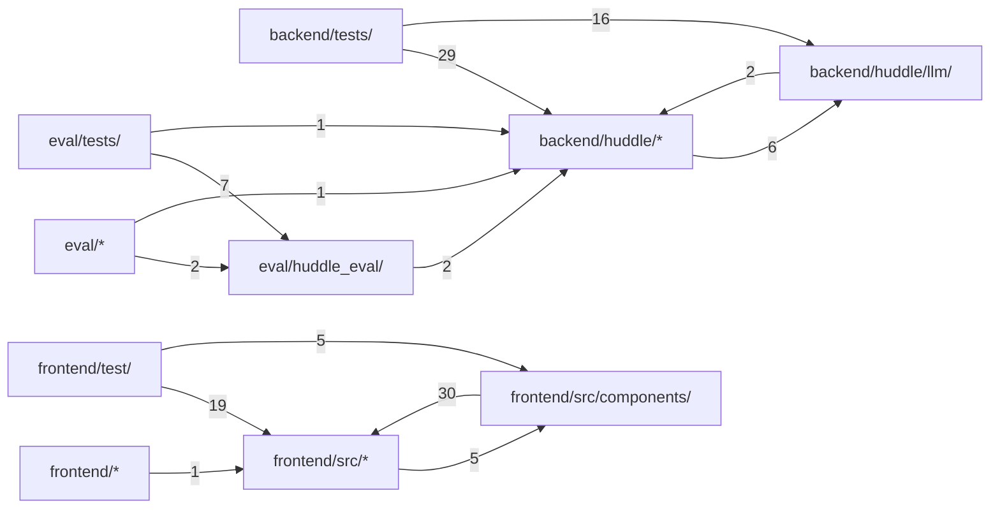

# Code structure

**English** · [中文](zh/structure.md)

Generated by Codocia from the code on every build: areas, each area's own description, import dependencies between areas, and the pages that explain them.

In scope: 145 files, 17,415 lines; excluded `**/*.lock`, `**/package-lock.json`, `eval/results/**`, `docs/img/**`, `**/*.png`, `frontend/dist/**`, `frontend/src/styles.css`, `frontend/.prettierrc`, `frontend/.gitignore`, `frontend/.dockerignore`, `.gitignore`, `.dockerignore`

## Files

**Repository root**

- (root files) — 476 lines, 7 files. Think a question through with a group of AI agents.\
  Explained in: [Overview](01-overview.md) (2), [Steering mid-answer](03-steering.md) (1), [Groups, memory and tools](04-groups-and-tools.md) (2), [Testing and evaluation](05-testing-and-evaluation.md) (1)
- `.github/` — 47 lines, 1 file\
  Explained in: [Testing and evaluation](05-testing-and-evaluation.md) (1)
- `config/` — 523 lines, 23 files\
  Explained in: [Overview](01-overview.md) (2), [How a turn works](02-how-it-works.md) (2), [Steering mid-answer](03-steering.md) (1), [Groups, memory and tools](04-groups-and-tools.md) (4)
- `scripts/` — 35 lines, 1 file\
  Hub files: `smoke.sh`\
  Explained in: not covered

**`backend/`**

- (files) — 34 lines, 2 files\
  Explained in: not covered
- `tests/` — 3,902 lines, 14 files\
  Explained in: [Testing and evaluation](05-testing-and-evaluation.md) (1)

**`backend/huddle/`**

- (files) — 3,697 lines, 17 files. Huddle backend.\
  Hub files: `config.py` `tools.py` `store.py`\
  Explained in: [Overview](01-overview.md) (4), [How a turn works](02-how-it-works.md) (8), [Steering mid-answer](03-steering.md) (9), [Groups, memory and tools](04-groups-and-tools.md) (8), [Limits and known gaps](06-limits.md) (2)
- `llm/` — 601 lines, 5 files\
  Hub files: `__init__.py` `fake.py` `base.py`\
  Explained in: [Overview](01-overview.md) (2), [How a turn works](02-how-it-works.md) (1), [Testing and evaluation](05-testing-and-evaluation.md) (1)

**`docs/`**

- (files) — 257 lines, 2 files\
  Explained in: [Overview](01-overview.md) (1)
- `specs/` — 895 lines, 6 files\
  Explained in: not covered

**`eval/`**

- (files) — 89 lines, 1 file\
  Hub files: `run.py`\
  Explained in: not covered
- `cases/` — 455 lines, 8 files\
  Explained in: [Testing and evaluation](05-testing-and-evaluation.md) (1)
- `huddle_eval/` — 724 lines, 3 files\
  Hub files: `core.py` `runner.py` `prompts.py`\
  Explained in: [Testing and evaluation](05-testing-and-evaluation.md) (3)
- `tests/` — 652 lines, 3 files\
  Explained in: [Testing and evaluation](05-testing-and-evaluation.md) (1)

**`frontend/`**

- (files) — 63 lines, 6 files\
  Hub files: `vite.config.ts`\
  Explained in: [Overview](01-overview.md) (1)
- `test/` — 896 lines, 13 files\
  Explained in: [Testing and evaluation](05-testing-and-evaluation.md) (1)

**`frontend/src/`**

- (files) — 1,350 lines, 16 files\
  Hub files: `types.ts` `api.ts` `profile.ts`\
  Explained in: [How a turn works](02-how-it-works.md) (1)
- `components/` — 1,419 lines, 12 files\
  Hub files: `MessageBubble.tsx` `ProfileDrawer.tsx` `Chat.tsx`\
  Explained in: not covered

**`sandbox/`**

- (files) — 892 lines, 3 files. A standard-library HTTP service that runs agent shell commands and manages per-conversatio…\
  Hub files: `server.py`\
  Explained in: [Groups, memory and tools](04-groups-and-tools.md) (1), [Limits and known gaps](06-limits.md) (1)
- `tests/` — 408 lines, 2 files\
  Explained in: [Testing and evaluation](05-testing-and-evaluation.md) (1)

## Dependencies

A → B means files in A import B; the number counts file-level imports. Showing the strongest 14 of 14 edges.

