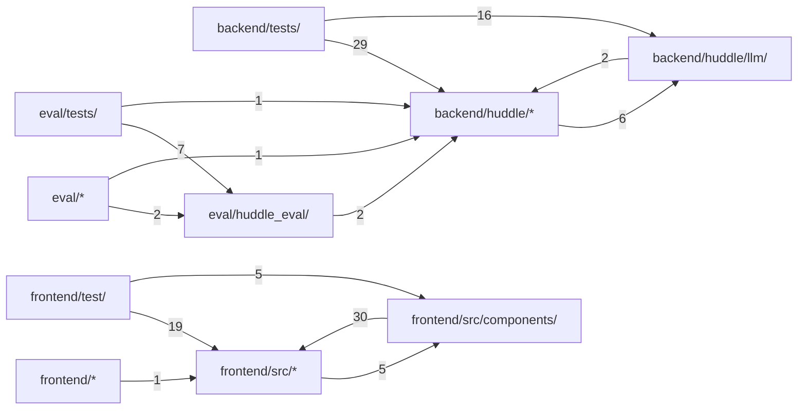

# Huddle

[English](../all.md) · **中文**

本书面向评估 Huddle 的读者：它做什么，一条消息如何流经运行时，回答途中的引导如何保持一致，以及它的边界在哪里。本书建立在[架构概览](../../architecture.md)、[配置](../../configuration.md)、[SECURITY.md](../../../SECURITY.md) 和[规范](../../specs/)之上，不重复其内容。

## 概览

Huddle 是一个网页群聊：一个人和一组 AI 智能体。每个智能体都有灵魂（它是谁）和私有记忆；几个智能体同时流式作答，彼此对话，只会重复别人时保持沉默，还能在写作途中被改变方向，而且仍是同一条消息。

运行时由两个对象承担：每个会话的 `Orchestrator` 决定谁发言（[一轮对话如何运作](#how-it-works)），每条可见消息对应一个 `AgentRun`，负责写出它并吸收引导（[回答途中的引导](#steering)）。[架构概览](../../architecture.md) 有图示和设计决策，[配置](../../configuration.md) 说明每一项设置，[SECURITY.md](../../../SECURITY.md) 说明沙箱防护什么；代码布局见 [代码结构](#structure)。Huddle 采用 Apache-2.0 许可；[CONTRIBUTING.md](../../../CONTRIBUTING.md) 说明各类改动应放在哪里。

来源: [orchestrator.py:30-44](../../../backend/huddle/orchestrator.py#L30-L44) · [agent.py:65-97](../../../backend/huddle/agent.py#L65-L97) · [LICENSE:1-3](../../../LICENSE#L1-L3)

### 运行

`docker compose up --build` 启动三个服务：端口 8080 上的静态 `frontend`（绑定到 `${HUDDLE_BIND:-127.0.0.1}`，默认只有本机能访问）、带有 SQLite 文件（存放在卷上）的 FastAPI `backend`，以及 `sandbox`。沙箱只接入一个 `internal` 网络：后端能访问它，它却访问不到互联网。设置 `HUDDLE_MODEL=fake` 会运行一个脚本化模型，不需要任何密钥。

`create_app` 把存储、注册表、编排器和沙箱客户端连接起来；启动时，若当前模型或某个已存储成员指定的模型缺少密钥就拒绝运行，把上一个进程遗留的 `streaming` 消息标记为已停止，并加载各个群组。

要给别人使用，在前端前面放任意一个 HTTPS 反向代理；`HUDDLE_BIND`、基础路径、不缓冲的 SSE 和转发的客户端地址见[在反向代理后运行](../../configuration.md#running-behind-a-reverse-proxy)。

来源: [docker-compose.yml](../../../docker-compose.yml) · [main.py:28-87](../../../backend/huddle/main.py#L28-L87) · [configuration.md:93-104](../../../docs/configuration.md#L93-L104)

### 切换模型

模型由配置选择：`HUDDLE_MODEL` 选中 `config/huddle.yaml` 中 `models:` 下的一项（默认 `deepseek`），`make_llm` 构建对应的提供方（`openai_chat` 适用于任何 Chat Completions API，另有 `openai_responses` 和 `fake`）。代码里不写死任何模型。

每次调用都带一个 *profile*：`decide`、`steer`、`utility`，或努力等级 `light`、`normal`、`deep`。`params_for` 把该项的 `default` 参数与此 profile 的参数深度合并；正是靠这一个设置，引导调用用最低推理档，深度工作用更高档。智能体可以指定自己的模型；`Orchestrator._llm` 为每个模型键缓存一个客户端。各字段说明见[模型](../../configuration.md#models)。

来源: [huddle.yaml:1-46](../../../config/huddle.yaml#L1-L46) · [config.py:57-66](../../../backend/huddle/config.py#L57-L66) · [__init__.py](../../../backend/huddle/llm/__init__.py) · [orchestrator.py:132-136](../../../backend/huddle/orchestrator.py#L132-L136)

### 提供方差异留在适配器里

运行时只看到一种事件流：`TextDelta`、`ToolCallDone` 和 `Done`。`OpenAIChat` 屏蔽差异：`_ThinkFilter` 去掉 `<think>` 块，`_MarkupFilter` 截掉某些模型以文本形式写出的原生工具调用标记（并在 `Done` 上以 `wanted_tools` 报告这次截断，见 [回答途中的引导](#steering)）；开启 `reasoning_passback` 后（`deepseek` 已开启），每条助手消息都带上自己的 `reasoning_content`，思考模型一旦涉及工具就要求如此。传输错误、429 和 5xx 只在产出第一个事件之前重试，因此重试绝不会重复可见文本。

来源: [openai_chat.py:15-41](../../../backend/huddle/llm/openai_chat.py#L15-L41) · [openai_chat.py:61-88](../../../backend/huddle/llm/openai_chat.py#L61-L88) · [openai_chat.py:101-186](../../../backend/huddle/llm/openai_chat.py#L101-L186) · [huddle.yaml:14-23](../../../config/huddle.yaml#L14-L23)

### 公开实例的防护

`guards.py` 保护别人也能访问的实例：用邀请码换取访问 cookie，由 `AccessMiddleware` 在任何路由运行前检查；按客户端的速率限制；每个会话的消息数和繁忙会话数上限；以及每日 token 预算。每项防护都要设置对应的环境变量才会开启，所以本地运行和测试都不需要它们。每次模型调用都经过 `MeteredLLM`，它记录提供方返回的用量或估算值，因此预算也计入 decide、去重和提取调用。按客户端的限制以 `client_ip` 为键，它从右往左数 `X-Forwarded-For`：前端的 nginx 追加它看到的地址，前面的 `HUDDLE_TRUST_PROXY` 个代理每个再追加一个（`true`/`yes`/`on` 表示一个），所以客户端自己写入的条目永远不被采信；`is_https` 只在受信任代理之后才相信 `X-Forwarded-Proto`。这些变量见[配置](../../configuration.md)；沙箱防护什么、不防护什么见 [SECURITY.md](../../../SECURITY.md)。

来源: [guards.py:1-5](../../../backend/huddle/guards.py#L1-L5) · [guards.py:56-131](../../../backend/huddle/guards.py#L56-L131) · [nginx.conf:13](../../../frontend/nginx.conf#L13) · [guards.py:195-280](../../../backend/huddle/guards.py#L195-L280) · [api.py:191-211](../../../backend/huddle/api.py#L191-L211) · +1

## 一轮对话如何运作

[架构概览](../../architecture.md) 画出了一条用户消息的完整流程。本页沿着代码走：事件如何排序、消息到达时发生什么、智能体如何决定发言，以及一轮为何会自行结束。消息内部的引导见 [回答途中的引导](#steering)；群组、讨论和工具见 [群组、记忆与工具](#groups-and-tools)。

来源: [orchestrator.py:355-385](../../../backend/huddle/orchestrator.py#L355-L385)

### 唯一的有序事件日志

每个可见变化都经过 `Store`：`add_message`、`append_text`、`finish_message` 和 `emit`。它们都会获取会话锁，递增 `conversations.last_seq`，在一个 SQLite 事务中写入表的变更和一行 `events`，并且只在提交之后才发布到进程内的 `Bus`。`_transaction` 保护提交不被取消，所以即使任务被取消，已提交的内容仍会发布：数据库里的事件绝不会在实时流中缺失。

消息的 `pos` 就是其 `message.created` 事件的 `seq`，因此它在聊天中的位置在创建时就已固定。对于不再处于 `streaming` 的消息，增量和 `message.tool` 都会被拒绝。

来源: [store.py:180-295](../../../backend/huddle/store.py#L180-L295) · [bus.py](../../../backend/huddle/bus.py)

### 快照、重放与缺口

浏览器先加载 `GET /api/conversations/{id}`：消息、`last_seq`、智能体状态和一个 `active` 标志，全部在同一把锁下读取，因此描述的是同一时刻。随后用 `?after=last_seq` 打开 SSE 流。服务器先订阅总线，*再*读取日志，重放已存事件后转发实时事件，并跳过任何不大于其游标的 `seq`，所以两者重叠也无妨。

客户端只接受恰好为 `lastSeq + 1` 的事件。出现缺口时，`connect` 关闭流，`App` 重新加载快照；网络出错时则从游标处重连。因此重新加载后看到的顺序总与实时视图一致。

来源: [store.py:297-313](../../../backend/huddle/store.py#L297-L313) · [api.py:173-189](../../../backend/huddle/api.py#L173-L189) · [api.py:249-280](../../../backend/huddle/api.py#L249-L280) · [state.ts:32-35](../../../frontend/src/state.ts#L32-L35) · [api.ts:123-166](../../../frontend/src/api.ts#L123-L166) · +1

### 消息到达时

`on_user_message` 在会话锁下完成全部记账：轮次加一，存储消息，并算出它的 `targets`（消息中点名的智能体；若是对全体说话则为所有人；词表在 `config/language.yaml` 中）。接着二选一：

- 纯停止短语会取消目标运行（见 [回答途中的引导](#steering)）。
- 否则，被点名的运行中智能体（无人被点名时则是全部运行中的智能体）会在收件箱里收到这条消息。指令提取在后台启动，上一轮的驱动任务被取消，新的 `_turn` 任务以空闲智能体为候选开始。

取消旧驱动绝不会取消正在写的智能体：运行通过 `asyncio.shield` 等待，所以新消息改变的是接下来谁发言，而不是已经在写的内容。

来源: [orchestrator.py:168-216](../../../backend/huddle/orchestrator.py#L168-L216) · [orchestrator.py:457-461](../../../backend/huddle/orchestrator.py#L457-L461) · [language.yaml:5-22](../../../config/language.yaml#L5-L22)

### 决定谁发言

每一回合，每个候选者都从*自己的*上下文发起一次小的 `decide` 调用（因此私有记忆会影响决定），返回 JSON：`speak`、`effort`、`addresses` 和简短的 `point`。提示词把沉默设为默认：只有带来新的事实、数字、风险或提议时才发言。`complete_json` 容忍 JSON 周围的文字，并能修复被截断的对象；失败或格式错误的决定退回到"仅在被点名时发言"。

随后代码在第 0 回合约束模型的选择：若无人想发言，就选出一位（被点名者、有观点者，或上一个发言者），所以每个新问题都有回复（只引导了正在写的智能体的消息是例外，见 [回答途中的引导](#steering)）；请求文件会把写作者提升到 `deep`；对未点名问题的多个 `light` 回答合并为一个；有些消息会开启自由讨论（[群组、记忆与工具](#groups-and-tools)）。

来源: [orchestrator.py:249-278](../../../backend/huddle/orchestrator.py#L249-L278) · [orchestrator.py:385-403](../../../backend/huddle/orchestrator.py#L385-L403) · [orchestrator.py:414-425](../../../backend/huddle/orchestrator.py#L414-L425) · [prompts.py:105-130](../../../backend/huddle/prompts.py#L105-L130) · [base.py:49-98](../../../backend/huddle/llm/base.py#L49-L98)

### 并行开始，暂扣输出

当两个或以上智能体想发言时，它们的运行立即开始，但处于*暂扣*状态：文本积累在运行的缓冲区里，不创建消息。与此同时，`_dedupe` 通过一次工具性调用判断哪些提议的观点彼此重复，或与最近的对话重复。用户点名的智能体从不被去掉，并且至少保留一位发言者。然后 `_resolve_held` 放行保留的运行，它们创建消息并刷新缓冲区；其余的被取消，永远不会出现。

这样生成与去重重叠进行，繁忙的一轮不会因为保持安静而多付延迟。消息的位置在发布时固定，而不是在智能体开始思考时。

来源: [orchestrator.py:431-455](../../../backend/huddle/orchestrator.py#L431-L455) · [orchestrator.py:280-323](../../../backend/huddle/orchestrator.py#L280-L323) · [agent.py:99-128](../../../backend/huddle/agent.py#L99-L128) · [agent.py:160-197](../../../backend/huddle/agent.py#L160-L197)

### 后续回合与一轮的结束

一回合结束后，下一批候选者取决于实际写出的内容。`_message_targets` 只读取已完成的文本：`@Name`、同一句中名字后跟问号，或移交（"that's Theo's call"）；这些模式在 `config/language.yaml` 中。`decide` 返回的 `addresses` 字段被忽略，因为模型会在其中列出所有人，每条消息都变成了邀请。

在讨论或合并回合之外，只有被点名的空闲智能体才是候选者。当无人发言、达到回合上限或触及每轮消息上限时，循环停止；`_turn_cap` 为大群组放宽上限，让每个人都能发言一次。这就是一轮会自行结束、而不会变成无尽往来的原因。

来源: [orchestrator.py:325-328](../../../backend/huddle/orchestrator.py#L325-L328) · [orchestrator.py:342-353](../../../backend/huddle/orchestrator.py#L342-L353) · [orchestrator.py:367-380](../../../backend/huddle/orchestrator.py#L367-L380) · [orchestrator.py:462-469](../../../backend/huddle/orchestrator.py#L462-L469) · [language.yaml:48-56](../../../config/language.yaml#L48-L56) · +1

### 每个智能体看到什么

`build_context` 为每次调用重新构建提示词。系统消息包含智能体的灵魂、记忆、群组共享上下文、公开名单和常驻指令。之后是对话记录：智能体自己的消息作为 `assistant`，用户和同伴的消息作为带标签的 `user` 条目（仍在输入的同伴会被标注）。工具调用和结果只出现在智能体自己最近的消息中（`own_step_messages`）；谁也看不到别的智能体的工具历史或记忆。

为了放进 `context_tokens`，会从最旧开始丢弃整段对话块，因此工具结果永远不会与其调用分离。正在续写的消息和引导说明受保护。附加指令和常驻指令提醒附加在最后一个 user 条目上，是模型最后读到的内容。

来源: [context.py:73-132](../../../backend/huddle/context.py#L73-L132) · [prompts.py:49-86](../../../backend/huddle/prompts.py#L49-L86)

## 回答途中的引导

引导是在智能体写作期间到达的用户消息。Huddle 不会停下智能体再开始新回复：同一条消息从读者已看到的位置精确续写，并应用新的要求。这个循环是 Huddle 自己的（不用智能体框架），因为它必须让模型流与收件箱赛跑，并保持事件日志一致。[架构概览](../../architecture.md) 有时序图。

来源: [agent.py:65-97](../../../backend/huddle/agent.py#L65-L97) · [AGENTS.md:5-6](../../../AGENTS.md#L5-L6) · [CONTRIBUTING.md:3-4](../../../CONTRIBUTING.md#L3-L4)

### 运行循环

`AgentRun.run` 重复同一个步骤。在会话锁下，它清空收件箱，加载新状态并构建上下文；若有待处理的引导，这次调用使用 `steer` profile 并包含它们。然后流式获取一次模型响应。之后：

- 有引导到达 → 立即再循环（续写）；
- 处于暂扣 → 等待放行或引导；
- 有工具调用 → 执行后再循环（工具预算见 [群组、记忆与工具](#groups-and-tools)）；
- 没有提供工具，但模型试图调用一个（`_wanted_tools`）→ 以 `deep` 努力等级把同一条消息重写一次，保留它所回应的引导；
- 否则 → 在锁下再清空一次收件箱，只有为空时才把消息标记为 `done`。

`finished` 在释放这把锁之前设置，而 `steer()` 会拒绝已完成的运行。因此一个引导要么被这次运行接收，要么被拒绝并作为新回复处理；绝不会在两者之间丢失。`_text` 会去掉消息开头的空行，所以空回复不会留下空消息。

来源: [agent.py:384-424](../../../backend/huddle/agent.py#L384-L424) · [agent.py:435-466](../../../backend/huddle/agent.py#L435-L466) · [agent.py:177-180](../../../backend/huddle/agent.py#L177-L180) · [agent.py:130-134](../../../backend/huddle/agent.py#L130-L134)

### 模型流与收件箱赛跑

`_stream` 同时保持两个任务：下一个模型事件和 `inbox.get()`。文本先缓冲，再按时间小批量（`flush_interval_s`）刷新为 `message.delta`。当引导赢得赛跑时，已经到达的增量仍会被消费并刷新，绝不丢弃；`finally` 块关闭生成器，从而关闭提供方的 HTTP 流。读者保留的正是已发布的内容，下一次调用就从这里开始。

来源: [agent.py:206-270](../../../backend/huddle/agent.py#L206-L270)

### 续写同一条消息

续写时，`build_context` 把智能体自己的部分消息移到末尾作为 `assistant` 条目，并加上 `steer_note`：用户写了什么、已显示的最后几个字符，以及从那里接着写、不重复、不重来、不提及被打断的规则。`steer` profile 要求提供方的最低推理档，这正是第一个转向后的词出得快的原因。

新文本通过 `seam` 与旧文本衔接：断在词中间时用 "… "，标点之后用一个空格。模型开头自带的省略号会被去掉，接缝不会重复。所有内容都写入同一个消息 id，所以聊天里显示的是一条改变了方向的消息。

来源: [context.py:97-106](../../../backend/huddle/context.py#L97-L106) · [prompts.py:22-35](../../../backend/huddle/prompts.py#L22-L35) · [prompts.py:164-182](../../../backend/huddle/prompts.py#L164-L182) · [agent.py:181-189](../../../backend/huddle/agent.py#L181-L189)

### 工具执行期间的引导

在两次模型调用之间，引导直接进入下一次调用。命令运行时，`_tools` 让工具任务与收件箱赛跑；引导会通过 `sandbox.kill` 杀掉该工作区的命令，并以"interrupted"结果答复这次调用，批次中剩余的调用也一样。等待去重的暂扣运行同样监听收件箱，所以运行尚不可见时引导也不会丢失。

来源: [agent.py:318-382](../../../backend/huddle/agent.py#L318-L382) · [agent.py:114-128](../../../backend/huddle/agent.py#L114-L128)

### 谁被引导

点名智能体的消息只引导这些运行，其他智能体照常写作。不点名的消息引导所有运行中的智能体。拒绝引导的运行（刚刚完成）会让该智能体成为新回复的候选者。若消息只引导了正在写的智能体，新的一轮就是*纯引导*：空闲智能体仍会做决定，但没有人被强制回答。

来源: [orchestrator.py:189-213](../../../backend/huddle/orchestrator.py#L189-L213)

### 停止

只包含停止短语（可带名字；短语在 `config/language.yaml` 中）的消息，或 Stop 按钮，会结束工作而不是引导。在锁下，`_stop_locked` 取消目标运行和所有指令提取，把它们的流式消息标记为 `stopped` 并清除输入状态；被取消的任务只在释放锁之后才等待，因此不会误收更新一轮的输出。被取消的运行丢弃未刷新的缓冲：停止不会再添加文本。停止后紧接着的未点名后续消息（"ok, the short version"）发给被停止的智能体。

来源: [orchestrator.py:502-550](../../../backend/huddle/orchestrator.py#L502-L550) · [orchestrator.py:330-340](../../../backend/huddle/orchestrator.py#L330-L340) · [agent.py:467-471](../../../backend/huddle/agent.py#L467-L471) · [language.yaml:5-6](../../../config/language.yaml#L5-L6)

### 常驻指令

"从现在起用中文回答"必须影响被引导的消息和之后的每一条。每条用户消息还会交给后台提取器，它存储持久指令，作用于所有人或某一个智能体。提取按到达顺序串联，所以即使连发多条，后来的指令也会覆盖先前的；下一轮最多等待 `extract_timeout_s` 让上一次提取完成。引导本身已经把要求应用到正在写的消息上。

指令位于每个系统提示词的末尾附近，紧挨在身份规则之前，并在每次调用末尾作为提醒再出现一次。这条规则就是唯一的限制：指令可以改变语言、长度、格式或重点，但绝不能改变智能体是谁。

来源: [orchestrator.py:201-207](../../../backend/huddle/orchestrator.py#L201-L207) · [orchestrator.py:218-242](../../../backend/huddle/orchestrator.py#L218-L242) · [orchestrator.py:361-366](../../../backend/huddle/orchestrator.py#L361-L366) · [prompts.py:78-86](../../../backend/huddle/prompts.py#L78-L86)

### 每个会话一把锁

凡是必须与日志一致的决定（创建消息、在 `done` 之前清空收件箱、停止、快照）都在会话的 `ConversationLock` 下运行。它在同一任务内可重入，所以运行可以持有它并调用会再次获取它的 `Store` 方法，但从不与子任务共享。若进程在回答途中退出，启动时会把所有 `streaming` 消息标记为 `stopped`；没有任何内容被重排或改写。

来源: [store.py:55-90](../../../backend/huddle/store.py#L55-L90) · [store.py:362-364](../../../backend/huddle/store.py#L362-L364)

## 群组、记忆与工具

智能体是谁、知道什么、能做什么，都是数据而不是代码。本页介绍群组及其成员、两种多回合模式（自由讨论和合并），以及工具：沙箱、网络研究和 `remember`。

来源: [huddle.yaml:48-50](../../../config/huddle.yaml#L48-L50)

### 群组是数据

群组是一组智能体加上每个成员都知道的共享上下文。`config/groups/` 中附带三个预设：创业公司领导团队（3 人）、一个家庭（5 人）和发布作战室（10 人）。每个预设是一个带 frontmatter 的 `group.md`，加上每个智能体一个 markdown 文件，其中 `## Persona`（灵魂）和 `## Private knowledge`（记忆）两节；格式见[群组](../../configuration.md#groups)。

首次启动时，`AgentRegistry` 把预设写入 SQLite；此后数据库是唯一来源，每次编辑都会递增 `registry.version`，使用于识别点名的名字模式缓存失效。会话存储自己的群组键，编排器每轮都读取该群组的成员。提示词不含任何预设名字或事实，所以同一套规则既适用于家庭，也适用于公司。

来源: [agents.py:49-123](../../../backend/huddle/agents.py#L49-L123) · [config.py:90-106](../../../backend/huddle/config.py#L90-L106) · [orchestrator.py:51-72](../../../backend/huddle/orchestrator.py#L51-L72) · [CONTRIBUTING.md:26-29](../../../CONTRIBUTING.md#L26-L29)

### 编辑灵魂与记忆

应用通过 `/api/groups/{group}/agents` 编辑成员，通过 `PUT /api/groups/{group}` 编辑群组共享上下文。`AgentRegistry` 校验名字（组内唯一，可用任何文字）、颜色和文本长度，限制群组人数，并由名字生成稳定的键。这些上限是 `config/huddle.yaml` 中的 `limits.fields`；网页应用通过 `GET /api/config` 读取同样的数字，所以浏览器和服务器从不冲突。重置会从文件重新写入预设。编辑是全局的：该群组的每个会话在下一次调用时都会看到，因为上下文每次调用都重新构建（[一轮对话如何运作](#how-it-works)）。

来源: [agents.py:126-193](../../../backend/huddle/agents.py#L126-L193) · [agents.py:239-244](../../../backend/huddle/agents.py#L239-L244) · [api.py:92-160](../../../backend/huddle/api.py#L92-L160) · [huddle.yaml:82-84](../../../config/huddle.yaml#L82-L84)

### remember 工具

`remember` 往智能体自己的记忆里追加一条简短笔记，放在 `## Remembered` 下。记忆由群组的所有会话共享，所以只有当对方的消息（或送达该运行的引导消息）提到"记住"时，才提供这个工具，每条消息一次：`config/language.yaml` 里的 `remember` 模式会设置 `RunContext.can_remember`。执行时还会再检查：没有它的 `remember` 调用，或者调用了未提供的工具，都会以错误作答，绝不执行。笔记长度上限为 `remember_note` 个字符；记忆已满时会拒绝笔记，而不是截掉旧事实。

来源: [agents.py:220-237](../../../backend/huddle/agents.py#L220-L237) · [agent.py:307-316](../../../backend/huddle/agent.py#L307-L316) · [agent.py:431-434](../../../backend/huddle/agent.py#L431-L434) · [agent.py:332-335](../../../backend/huddle/agent.py#L332-L335) · [orchestrator.py:433-435](../../../backend/huddle/orchestrator.py#L433-L435) · +2

### 自由讨论

明确的"讨论/辩论"请求（词表在 `config/language.yaml` 中），或两个以上智能体想以 `deep` 努力回答的难题，会把这一轮变成讨论。回合数和消息上限提高，每个空闲智能体可以回应有限次数，decide 提示词切换为"回应别人刚说的，否则保持沉默"。除非请求了文件，讨论消息保持聊天长度且不用工具。

若讨论至少有 `conclusion_min_messages` 条消息、来自至少两个智能体，`_conclude` 会让第一个发言者再运行一次，带上撰写群组结论的指示：建议、附关键数字的理由，以及谁仍持异议。

来源: [orchestrator.py:404-413](../../../backend/huddle/orchestrator.py#L404-L413) · [orchestrator.py:426-430](../../../backend/huddle/orchestrator.py#L426-L430) · [orchestrator.py:478-500](../../../backend/huddle/orchestrator.py#L478-L500) · [prompts.py:97-102](../../../backend/huddle/prompts.py#L97-L102) · [prompts.py:235-244](../../../backend/huddle/prompts.py#L235-L244)

### 合并回合

像"要不要接这单生意？"这样的问题，需要分散在不同记忆里的事实。两部分配合起作用。系统提示词要求每个智能体直白地陈述自己的私有事实（最初的要求和截止日期，而不只是它偏好的折中方案）。然后，若第一回合中至少有两个智能体发言、且至少一个的努力高于 `light`，每个空闲智能体都获得一次合并回合：只有当能把别人刚分享的事实与自己的事实结合成一个无人说过的结论时才发言。

来源: [orchestrator.py:470-481](../../../backend/huddle/orchestrator.py#L470-L481) · [prompts.py:89-94](../../../backend/huddle/prompts.py#L89-L94) · [prompts.py:66](../../../backend/huddle/prompts.py#L66)

### 努力等级决定工具权限

努力等级决定消息的长度建议、token 上限和工具预算；只有 `deep` 有沙箱工具预算（`max_tool_steps`）。运行一旦用过工具，超出预算后仍会在 `tool_budget_grace_steps` 步内继续提供工具，但这些调用会返回"预算已用完"：中途撤掉工具会让某些模型把原始工具标记写成文本。宽限步数用完后工具被撤下，从而终止不停调用的模型。网页调用另有每条消息的上限。每批工具调用之后，运行比较前后的工作区文件列表并发出 `file.changed`，刷新文件面板。

来源: [huddle.yaml:56-59](../../../config/huddle.yaml#L56-L59) · [agent.py:425-430](../../../backend/huddle/agent.py#L425-L430) · [agent.py:377-382](../../../backend/huddle/agent.py#L377-L382) · [prompts.py:6-10](../../../backend/huddle/prompts.py#L6-L10)

### 网络研究

由于沙箱没有网络，`web_search` 和 `fetch_url` 在后端运行。只允许 http 和 https；重定向手动跟随，每一跳的主机只要有任何地址是私有、回环、链路本地、组播地址或云元数据名称就拒绝。随后 `page_client` 只连接通过该检查的地址（`_PublicOnlyBackend` 在连接时只解析一次名称），所以 DNS 重绑定到不了私有地址。大小、时间和文本长度都有上限，错误以普通句子交给模型。每个结果都会连同来源链接写入工作区的研究文件夹，方便人核对智能体读过什么。

来源: [web.py:1-9](../../../backend/huddle/web.py#L1-L9) · [web.py:140-207](../../../backend/huddle/web.py#L140-L207) · [web.py:456-507](../../../backend/huddle/web.py#L456-L507) · [web.py:533-562](../../../backend/huddle/web.py#L533-L562) · [tools.py:116-129](../../../backend/huddle/tools.py#L116-L129)

### 沙箱

`bash`、`read_file` 和 `write_file` 通过 HTTP 发往一个只用标准库、运行在独立容器中的服务：非 root 用户、只读根文件系统、没有任何 capabilities、限制 CPU、内存和进程数，且无法连接互联网。每个会话有一个工作区目录。命令以 `bash -c` 在新会话中运行，环境最小化，超时被钳制，输出有上限，每个工作区最多同时运行四条命令。终止针对整个进程组，直到它彻底消失，所以 fork 炸弹可以恢复；`sweep_detached`（`HUDDLE_SANDBOX_SWEEP=1`，由 `sandbox/Dockerfile` 设置）还会杀掉用 `setsid()` 离开自身会话的进程。空闲工作区在 TTL 之后删除。磁盘预算计入隐藏文件，命令运行期间大约每秒检查一次（尽力而为）。[SECURITY.md](../../../SECURITY.md) 说明了它不防护什么。

来源: [server.py:451-475](../../../sandbox/server.py#L451-L475) · [server.py:649-674](../../../sandbox/server.py#L649-L674) · [server.py:312-342](../../../sandbox/server.py#L312-L342) · [server.py:345-355](../../../sandbox/server.py#L345-L355) · [server.py:729-741](../../../sandbox/server.py#L729-L741) · +4

## 测试与评估

Huddle 有两层检查。单元和集成测试离线运行，使用脚本化模型；评估运行器用真实模型驱动一个正在运行的实例，并为得到的对话打分。测试命令见 [CONTRIBUTING.md](../../../CONTRIBUTING.md)；测试计划见[测试规范](../../specs/testing.md)，[评估规范](../../specs/eval.md)给出数据集格式和运行器命令。

来源: [AGENTS.md:5-12](../../../AGENTS.md#L5-L12)

### 离线测试

后端测试从不访问网络。`FakeLLM` 按智能体、profile 和提示词文本的规则回复，分块和延迟都可配置，所以测试可以让 Theo 慢慢流式输出，并在消息中途发送引导。`FakeSandbox` 记录命令，并能阻塞某条命令直到放行，引导工具调用的测试就是这样做的。大部分运行时用例（引导、停止短语、点名、回合、接缝）位于 `backend/tests/test_runtime.py`。

前端测试（Vitest）覆盖事件归约器（包括缺口检测），以及群组、资料和跟随滚动等辅助函数。沙箱测试启动真实服务并运行真实进程。评估测试在小型合成事件日志上运行检查、指标和对话记录标记。CI 在每次推送和拉取请求时运行全部四套测试；[CONTRIBUTING.md](../../../CONTRIBUTING.md) 列出了同样的命令。

来源: [fake.py:1-46](../../../backend/huddle/llm/fake.py#L1-L46) · [conftest.py:13-38](../../../backend/tests/conftest.py#L13-L38) · [test_runtime.py:277-308](../../../backend/tests/test_runtime.py#L277-L308) · [state.test.ts:44-58](../../../frontend/test/state.test.ts#L44-L58) · [test_server.py:15-30](../../../sandbox/tests/test_server.py#L15-L30) · +2

### 评估数据集

`eval/cases/*.yaml` 包含 36 个覆盖全部三个群组的脚本化对话。每个用例列出步骤（`say`、`wait` 等待某智能体写到若干字符或进入空闲、`stop`、`reload`、`burst`）、确定性的 `checks`，以及自然语言的 `judge` 陈述。类别涵盖引导、停止、沉默、智能体之间的往来、合并知识、对抗输入（提示词注入、恶意 shell 命令）以及更大的群组。

来源: [steer.yaml:1-30](../../../eval/cases/steer.yaml#L1-L30) · [core.py:14-20](../../../eval/huddle_eval/core.py#L14-L20) · [core.py:106-136](../../../eval/huddle_eval/core.py#L106-L136)

### 运行器如何打分

`eval/run.py` 是黑盒的：它通过 HTTP 创建会话，带接收时间戳跟随 SSE 流，并执行各个步骤。"空闲"由服务器判定，而不是一段静默期：快照的 `active` 标志为假、没有智能体在输入或流式输出，且最后一次发送已过去至少 1.5 秒，连续两次轮询都如此，所以较慢的 decide 调用不会被误判为结束。最后它重新加载，并把事件冻结在快照的 `last_seq`。

确定性检查是硬性门槛：`same_message_continued`（按服务器的 `seq` 顺序而非客户端时钟，同一条消息在后一条用户消息存储前后都有增量）、`no_new_text_after_stop`、`reload_identical`（快照等于事件日志的重放）、隐私方面的 `no_leak` 短语、`ui_words_absent`（不谈引导或指令），以及发言者集合、努力等级、文件和延迟。评审是一个配置好的模型（`--judge`，否则用当前模型），它读取在精确字符位置插入了"用户消息到达"标记的对话记录，对每条陈述给出判定和理由。

来源: [runner.py:310-375](../../../eval/huddle_eval/runner.py#L310-L375) · [runner.py:46-53](../../../eval/huddle_eval/runner.py#L46-L53) · [core.py:93-105](../../../eval/huddle_eval/core.py#L93-L105) · [core.py:142-160](../../../eval/huddle_eval/core.py#L142-L160) · [core.py:240-270](../../../eval/huddle_eval/core.py#L240-L270) · +1

### 延迟指标

每次发送有两个数字。首词：从发送返回到该轮智能体消息出现第一段文本的时间。引导延迟：从发送的 POST 到一条已在流式输出的消息中续写的第一个词的时间；若发送中点了名，则只看被点名的智能体。模型在引导之前写下的文本仍会在引导之后立即刷出，所以 `continuation_arrival` 取引导之后存储的、按服务器时钟比引导和前一个增量都晚至少 `CONTINUATION_GAP_S`（一次模型往返）的第一个增量；这是估计值，自行停顿那么久的流也会被当作续写。结果按每次运行写成 JSON。

来源: [core.py:164-237](../../../eval/huddle_eval/core.py#L164-L237)

## 限制与已知缺口

Huddle 的范围取舍是有意的，在代码中可以看到：

- **单进程。** 每个 `Orchestrator` 把它的会话及正在进行的回答保存在内存中；启动时 `stop_streaming_on_startup` 把仍处于 `streaming` 的消息全部标记为 `stopped`，所以重启会结束正在进行的回答。
- **单用户，无账户。** `has_access` 只核对一个邀请码（或者不设）；通过的人能看到所有会话。
- **一个沙箱容器。** 每个会话在同一根目录下有自己的工作区目录，但命令以同一个用户运行，所以目录只是分隔，不是安全边界。
- **共享群组。** `AgentRegistry` 为每个实例只保存一套群组；编辑对所有人生效。

[SECURITY.md](../../../SECURITY.md) 列出了安全方面的限制。下面补充从此提交的代码中可以看出的缺口。

来源: [orchestrator.py:35-37](../../../backend/huddle/orchestrator.py#L35-L37) · [main.py:64-66](../../../backend/huddle/main.py#L64-L66) · [store.py:362-364](../../../backend/huddle/store.py#L362-L364) · [guards.py:205-210](../../../backend/huddle/guards.py#L205-L210) · [server.py:261-269](../../../sandbox/server.py#L261-L269) · +1

### 代码中可见的缺口

- **运行失败时只会道歉。** 若运行抛出异常（例如提供方在流中途失败），`_say_failed` 会在已发布的文本后追加一句固定的 `RUN_FAILED`；原因只留在服务器日志里。
- **后台调用可能丢失工作。** 指令提取超时很短且吞掉失败，所以常驻指令可能丢失，而引导本身仍已生效。decide 或去重调用失败时会退回到简单规则。
- **工具性调用使用默认模型。** 去重和提取忽略按智能体指定的模型。
- **只有一个数据库连接。** `Store` 用一把锁串行化所有会话的每次写入，对小型实例足够，但不适合大量用户。
- **长对话会遗忘。** 上下文裁剪先丢最旧的对话；受保护的续写内容仍可能超出上限。
- **DNS 重绑定只对页面读取堵住**：`fetch_url` 只连接刚检查过的地址（[群组、记忆与工具](#groups-and-tools)）；`web_search` 用普通客户端访问固定的搜索地址。

来源: [agent.py:279-299](../../../backend/huddle/agent.py#L279-L299) · [orchestrator.py:218-242](../../../backend/huddle/orchestrator.py#L218-L242) · [orchestrator.py:280-299](../../../backend/huddle/orchestrator.py#L280-L299) · [store.py:103-111](../../../backend/huddle/store.py#L103-L111) · [context.py:124-132](../../../backend/huddle/context.py#L124-L132) · +2

## 代码结构

本页由 Codocia 根据代码自动生成，每次 build 重新计算：功能区划分、各区自带的说明、区之间的 import 依赖，以及讲解各区的页面。

范围内共 145 个文件，17,415 行；已排除 `**/*.lock`、`**/package-lock.json`、`eval/results/**`、`docs/img/**`、`**/*.png`、`frontend/dist/**`、`frontend/src/styles.css`、`frontend/.prettierrc`、`frontend/.gitignore`、`frontend/.dockerignore`、`.gitignore`、`.dockerignore`

### 文件结构

**仓库根目录**

- （根目录文件） — 476 行，7 个文件。Think a question through with a group of AI agents.\
  讲解：[概览](#overview) (2), [回答途中的引导](#steering) (1), [群组、记忆与工具](#groups-and-tools) (2), [测试与评估](#testing-and-evaluation) (1)
- `.github/` — 47 行，1 个文件\
  讲解：[测试与评估](#testing-and-evaluation) (1)
- `config/` — 523 行，23 个文件\
  讲解：[概览](#overview) (2), [一轮对话如何运作](#how-it-works) (2), [回答途中的引导](#steering) (1), [群组、记忆与工具](#groups-and-tools) (4)
- `scripts/` — 35 行，1 个文件\
  核心文件：`smoke.sh`\
  讲解：未讲解

**`backend/`**

- （直接文件） — 34 行，2 个文件\
  讲解：未讲解
- `tests/` — 3,902 行，14 个文件\
  讲解：[测试与评估](#testing-and-evaluation) (1)

**`backend/huddle/`**

- （直接文件） — 3,697 行，17 个文件。Huddle backend.\
  核心文件：`config.py` `tools.py` `store.py`\
  讲解：[概览](#overview) (4), [一轮对话如何运作](#how-it-works) (8), [回答途中的引导](#steering) (9), [群组、记忆与工具](#groups-and-tools) (8), [限制与已知缺口](#limits) (2)
- `llm/` — 601 行，5 个文件\
  核心文件：`__init__.py` `fake.py` `base.py`\
  讲解：[概览](#overview) (2), [一轮对话如何运作](#how-it-works) (1), [测试与评估](#testing-and-evaluation) (1)

**`docs/`**

- （直接文件） — 257 行，2 个文件\
  讲解：[概览](#overview) (1)
- `specs/` — 895 行，6 个文件\
  讲解：未讲解

**`eval/`**

- （直接文件） — 89 行，1 个文件\
  核心文件：`run.py`\
  讲解：未讲解
- `cases/` — 455 行，8 个文件\
  讲解：[测试与评估](#testing-and-evaluation) (1)
- `huddle_eval/` — 724 行，3 个文件\
  核心文件：`core.py` `runner.py` `prompts.py`\
  讲解：[测试与评估](#testing-and-evaluation) (3)
- `tests/` — 652 行，3 个文件\
  讲解：[测试与评估](#testing-and-evaluation) (1)

**`frontend/`**

- （直接文件） — 63 行，6 个文件\
  核心文件：`vite.config.ts`\
  讲解：[概览](#overview) (1)
- `test/` — 896 行，13 个文件\
  讲解：[测试与评估](#testing-and-evaluation) (1)

**`frontend/src/`**

- （直接文件） — 1,350 行，16 个文件\
  核心文件：`types.ts` `api.ts` `profile.ts`\
  讲解：[一轮对话如何运作](#how-it-works) (1)
- `components/` — 1,419 行，12 个文件\
  核心文件：`MessageBubble.tsx` `ProfileDrawer.tsx` `Chat.tsx`\
  讲解：未讲解

**`sandbox/`**

- （直接文件） — 892 行，3 个文件。A standard-library HTTP service that runs agent shell commands and manages per-conversatio…\
  核心文件：`server.py`\
  讲解：[群组、记忆与工具](#groups-and-tools) (1), [限制与已知缺口](#limits) (1)
- `tests/` — 408 行，2 个文件\
  讲解：[测试与评估](#testing-and-evaluation) (1)

### 依赖结构

箭头 A → B 表示 A 中有文件 import 了 B，数字是这样的文件级 import 数。只画最强的 14 条（共 14 条）。

