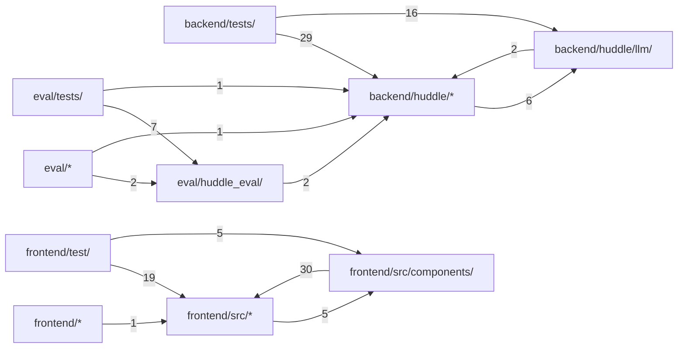

# 代码结构

[English](../structure.md) · **中文**

本页由 Codocia 根据代码自动生成，每次 build 重新计算：功能区划分、各区自带的说明、区之间的 import 依赖，以及讲解各区的页面。

范围内共 145 个文件，17,415 行；已排除 `**/*.lock`、`**/package-lock.json`、`eval/results/**`、`docs/img/**`、`**/*.png`、`frontend/dist/**`、`frontend/src/styles.css`、`frontend/.prettierrc`、`frontend/.gitignore`、`frontend/.dockerignore`、`.gitignore`、`.dockerignore`

## 文件结构

**仓库根目录**

- （根目录文件） — 476 行，7 个文件。Think a question through with a group of AI agents.\
  讲解：[概览](01-overview.md) (2), [回答途中的引导](03-steering.md) (1), [群组、记忆与工具](04-groups-and-tools.md) (2), [测试与评估](05-testing-and-evaluation.md) (1)
- `.github/` — 47 行，1 个文件\
  讲解：[测试与评估](05-testing-and-evaluation.md) (1)
- `config/` — 523 行，23 个文件\
  讲解：[概览](01-overview.md) (2), [一轮对话如何运作](02-how-it-works.md) (2), [回答途中的引导](03-steering.md) (1), [群组、记忆与工具](04-groups-and-tools.md) (4)
- `scripts/` — 35 行，1 个文件\
  核心文件：`smoke.sh`\
  讲解：未讲解

**`backend/`**

- （直接文件） — 34 行，2 个文件\
  讲解：未讲解
- `tests/` — 3,902 行，14 个文件\
  讲解：[测试与评估](05-testing-and-evaluation.md) (1)

**`backend/huddle/`**

- （直接文件） — 3,697 行，17 个文件。Huddle backend.\
  核心文件：`config.py` `tools.py` `store.py`\
  讲解：[概览](01-overview.md) (4), [一轮对话如何运作](02-how-it-works.md) (8), [回答途中的引导](03-steering.md) (9), [群组、记忆与工具](04-groups-and-tools.md) (8), [限制与已知缺口](06-limits.md) (2)
- `llm/` — 601 行，5 个文件\
  核心文件：`__init__.py` `fake.py` `base.py`\
  讲解：[概览](01-overview.md) (2), [一轮对话如何运作](02-how-it-works.md) (1), [测试与评估](05-testing-and-evaluation.md) (1)

**`docs/`**

- （直接文件） — 257 行，2 个文件\
  讲解：[概览](01-overview.md) (1)
- `specs/` — 895 行，6 个文件\
  讲解：未讲解

**`eval/`**

- （直接文件） — 89 行，1 个文件\
  核心文件：`run.py`\
  讲解：未讲解
- `cases/` — 455 行，8 个文件\
  讲解：[测试与评估](05-testing-and-evaluation.md) (1)
- `huddle_eval/` — 724 行，3 个文件\
  核心文件：`core.py` `runner.py` `prompts.py`\
  讲解：[测试与评估](05-testing-and-evaluation.md) (3)
- `tests/` — 652 行，3 个文件\
  讲解：[测试与评估](05-testing-and-evaluation.md) (1)

**`frontend/`**

- （直接文件） — 63 行，6 个文件\
  核心文件：`vite.config.ts`\
  讲解：[概览](01-overview.md) (1)
- `test/` — 896 行，13 个文件\
  讲解：[测试与评估](05-testing-and-evaluation.md) (1)

**`frontend/src/`**

- （直接文件） — 1,350 行，16 个文件\
  核心文件：`types.ts` `api.ts` `profile.ts`\
  讲解：[一轮对话如何运作](02-how-it-works.md) (1)
- `components/` — 1,419 行，12 个文件\
  核心文件：`MessageBubble.tsx` `ProfileDrawer.tsx` `Chat.tsx`\
  讲解：未讲解

**`sandbox/`**

- （直接文件） — 892 行，3 个文件。A standard-library HTTP service that runs agent shell commands and manages per-conversatio…\
  核心文件：`server.py`\
  讲解：[群组、记忆与工具](04-groups-and-tools.md) (1), [限制与已知缺口](06-limits.md) (1)
- `tests/` — 408 行，2 个文件\
  讲解：[测试与评估](05-testing-and-evaluation.md) (1)

## 依赖结构

箭头 A → B 表示 A 中有文件 import 了 B，数字是这样的文件级 import 数。只画最强的 14 条（共 14 条）。

